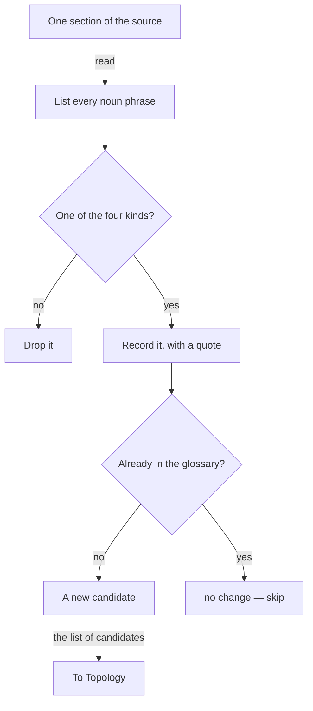

# Ontology — find the candidates and what they mean

> **What this is** — the first lens. It finds every candidate in one section and states what each one means. It is the only lens that adds new candidates.
> **What it is not** — it does not place candidates (that is `lens2-topology.md`), find their states (`lens3-choreography.md`), or judge which qualify (`otc-run-rules.md`). Definitions are finalised at Gate 2.
> **Related docs**
>
> - `otc-methodology.md` (how the lenses connect)
> - `lens2-topology.md`
> - `lens3-choreography.md`
> - `otc-run-rules.md`
> - `output-formats.md`
> - words: `method-words.md`
>
> **Next step** — its candidate table feeds `lens2-topology.md` and `lens3-choreography.md`.

## Input

- **One section** of the source — one coherent part (e.g. "Checkout"), never the whole corpus at once. A *section* is one part of the source, read on its own, taken from the source's own headings.
- **The existing glossary** — empty on a new build; populated on a re-run.

## How this stays repeatable

Fixed steps, a closed keep-rule and a closed drop-list, a **mandatory evidence quote on every row**, and
one fixed output table. Anything without a quote is not a candidate. Two runs are therefore diffable, and the
gate confirms the result.

---

## Ontology at a glance

This blows out the first lens: read the section, keep the real candidates, and hand the list of candidates to Topology.

## Procedure — do in order

1. **List** every noun phrase in the section. (Mechanical — do not judge yet.)
2. **Keep** a noun phrase only if it is one of the four KINDS below.
3. **Drop** anything on the DROP list, even if step 2 kept it.
4. **Record** one row per survivor in the output table, each with an exact quote.
5. **Mark** each row against the existing glossary: `add` (not present) or `no change` (already a term — stop here; merge or change is decided in `otc-run-rules.md`).

Ontology casts a **wide net** — keep anything that could be a product term. The narrowing (is it *worth* a
glossary entry?) is done by the three tests in `otc-run-rules.md`, at the gate. This lens's job is to miss nothing
and to drop only obvious noise.

## KEEP — a candidate is one of exactly four kinds

| Kind | What it is | Example |
|---|---|---|
| **object** | something the product stores, shows, or acts on | order, cart, receipt, refund |
| **role** | a person the product serves, records, or gives access to | customer, admin |
| **step** | a named stage of the work | checkout, returns |
| **state or value** | a named condition, or a member of a closed set | cancelled; {card, wallet, bank transfer} |

## DROP — never a candidate

| Drop | Because | Example |
|---|---|---|
| everyday words | no product-specific meaning | page, list, screen, button, click |
| mechanism / "how" words | describe the build, not the product | API, database, cache, retry, endpoint |
| a bare modifier | it does not stand on its own | quick, deep, smart → keep the *noun* it qualifies |
| used once, obvious | the one sentence already carries it | a passing "a note" mentioned nowhere else |
| formatting artifacts | styling, not meaning | a bolded label like **Objective.** |

---

## Rules this lens enforces (inline)

- Keep only the four kinds: object, role, step, state or value.
- Drop the drop-list: everyday words, mechanism / "how" words, bare modifiers, used-once-obvious, formatting.
- Every kept candidate carries an exact evidence quote — no quote, not a candidate.
- Cast a wide net; the narrowing (the three tests, especially reach) is a rule applied over the assembly draft, in `otc-run-rules.md`.

## Output format — one table per kind

Ontology's output goes into part 1 of the section draft, "The candidates found", filled from `templates/section-glossary.md`; the words it drops go into part 5, "Words dropped". Ontology writes **a separate table for each kind**:
- Objects
- Roles
- Steps
- States and values

The table's heading *is* the kind, so there is no "Kind" column. Every table uses the columns of part 1 of `templates/section-glossary.md`, copied exactly as the template writes them; the template's column guide says what each one holds. Two of them carry a rule:
- **Meaning** - what the source says the candidate is, in at most 12 words.
- **Evidence** - the exact quote from the source, and where it is.

The **Re-run** cell holds one of:
- `add`
- `merge`
- `change`
- `no change`

On a new build every row is `add`; on a re-run the Re-run column does the work (see below). An empty table is kept and marked **None.** - an honest empty beats a padded one.

The **Candidate** cell, and each value in a States and values row, is written in sentence case per G6 in `glossary-assembly-principles.md`, exactly as it will look in the glossary: "Quick scan", "Running". The **Evidence** cell is a quote and keeps the source's own casing.

## Worked example — from the real requirements

We use **one section across all three lenses** (Ontology → Topology → Choreography), so you can watch the same candidates carry forward.

> "The quick scan can be paused, resumed, stopped, and restarted; a stopped scan is incomplete, and the deep read stays closed until the scan resumes. Deep analysis reads a source in depth and presents its result. The result presents the as-is organised by business domain; each domain opens to its journeys and its modules. Every finding — a domain fact, a coupling, a gap — can be opened to the evidence."

**Objects**

| # | Candidate | Meaning | Evidence | Re-run |
|---|---|---|---|---|
| 1 | Source | the attached code read in depth | "reads a source in depth" | add |
| 2 | Result | what the deep read presents | "presents its result" | add |
| 3 | As-is | the system as it is today | "the as-is organised by business domain" | add |
| 4 | Domain | an area the result is organised by | "organised by business domain" | add |
| 5 | Journey | part of a domain | "each domain opens to its journeys" | add |
| 6 | Module | part of a domain | "and its modules" | add |
| 7 | Finding | a cited item — a domain fact, a coupling, or a gap | "Every finding — a domain fact, a coupling, a gap" | add |
| 8 | Evidence | what supports a finding | "can be opened to the evidence" | add |

**Roles**

| # | Candidate | Meaning | Evidence | Re-run |
|---|---|---|---|---|
| - | None. | this section names no roles | - | - |

**Steps**

| # | Candidate | Meaning | Evidence | Re-run |
|---|---|---|---|---|
| 1 | Quick scan | the first read across every source *(also seen as "the scan")* | "The quick scan can be paused, resumed, stopped, and restarted" | add |
| 2 | Deep read | reads one source in depth *(also seen as "deep analysis")* | "Deep analysis reads a source in depth" | add |

**States and values**

| # | Candidate | Meaning | Evidence | Re-run |
|---|---|---|---|---|
| 1 | Scan run state | • Running • Paused • Stopped • Restarted | "paused, resumed, stopped, and restarted" | add |
| 2 | Scan result | • Incomplete (once stopped) | "a stopped scan is incomplete" | add |

**Dropped - and why (so the wrong pick is not made):**

| Phrase | Dropped | Why |
|---|---|---|
| "**business** domain" | business | a modifier; the candidate is **domain** |
| "reads a source **in depth**" | in depth | a manner, not a noun |
| "the scan **resumes**" | resumes | a verb, not a noun |

Note the alternates: Ontology only *records* that "the scan" and "deep analysis" name candidates already listed — it does not pick the winner. That is the same-meaning test in `otc-methodology.md`, decided at the gate.

## When the glossary already exists (a re-run)

Re-running this section after "source", "quick scan", "deep read", and "evidence" are already terms - the Re-run column carries the meaning, and most rows are `no change`. The tables keep every column of a new build; only the Re-run cells differ:

**Objects**

| # | Candidate | Meaning | Evidence | Re-run |
|---|---|---|---|---|
| 1 | Source | the attached code read in depth | "reads a source in depth" | no change |
| 2 | Result | what the deep read presents | "presents its result" | add |
| 3 | Evidence | what supports a finding | "can be opened to the evidence" | no change |

**Steps**

| # | Candidate | Meaning | Evidence | Re-run |
|---|---|---|---|---|
| 1 | Quick scan | the first read across every source | "The quick scan can be paused..." | no change |
| 2 | Deep read | reads one source in depth | "Deep analysis reads a source in depth" | no change |
| 3 | Deep analysis | reads one source in depth | "Deep analysis reads a source in depth" | merge |

What each row leads to:
- **`no change`** - skipped: the glossary already has the term. Here that is Source, Evidence, Quick scan, and Deep read; Evidence is known even though another section owns it.
- **`add`** - added: Result.
- **`merge`** - raised for a person: Deep analysis may have the same meaning as Deep read, so it goes to the same-meaning test.

Nothing is silently re-added; only drift against the existing glossary stands out.

---

## Writing a definition

Definitions are written after Gate 1 (harvest step 7), for every term that came through it, and approved by the person at Gate 2. Each becomes the term's `What it is` cell in the glossary. These rules make every definition read the same way and say only what the source says:

1. **Start from the source.** Build the definition from the term's Meaning in the section drafts, joining the meanings from every section the term appears in. Every part of it must trace back to a quote; add nothing the source does not say.
2. **One sentence, at most 25 words**: *what it is*, then *what sets it apart*.
3. **A fixed opening by kind**, so every definition starts the same way:

   | Kind | Opens with | Example |
   |---|---|---|
   | Object | "A ..." or "The ..." | Cart: "A list of items a shopper intends to buy, kept until payment." |
   | Role | "A person who ..." | Shopper: "A person who browses the catalogue and places orders." |
   | Step | "The stage where ..." | Checkout: "The stage where the shopper confirms the cart and pays." |
   | State or value | "The condition of a {term} when ..." | Order status: "The condition of an order as it moves from placement to delivery." |

4. **What it is, not what happens to it.** No rules or behaviour ("cannot ship until paid"); those belong in the flow in `step-terms.md`.
5. **No "how" words** - no screens, buttons, APIs, or databases - the same line the DROP list holds.
6. **Never circular.** Do not define a term with itself ("a cart is a cart for items").
7. **Other terms use their agreed words**, never a retired one, and are lower case inside the sentence ([G6](glossary-assembly-principles.md#g6)).
8. **A value-set names what it qualifies**; the values themselves go in the `Values` column, not in the sentence.
9. **If the source never states the meaning**, write `Pending - meaning not stated in source`, and make sure a Gate 1 question exists for it. Never guess.
10. **Simple words.** The definition follows `../simple-writing-rules.md`: everyday words, no figure of speech, and nothing a reader whose first language isn't English would have to guess. A word from the source that is hard to read is kept only as "also written as".

At Gate 2 the person checks each definition against these ten rules and approves or edits the wording.

---

## Hand-off

The candidate table (`add` rows) goes to **Topology** (to place them) and **Choreography** (to find their
states). `no change` rows stop here. Nothing from this lens is a final glossary entry yet — that happens at
Gate 2, after `otc-run-rules.md` has judged which candidates qualify.
