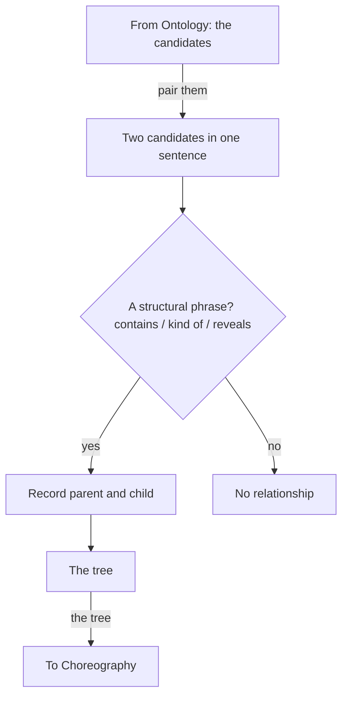
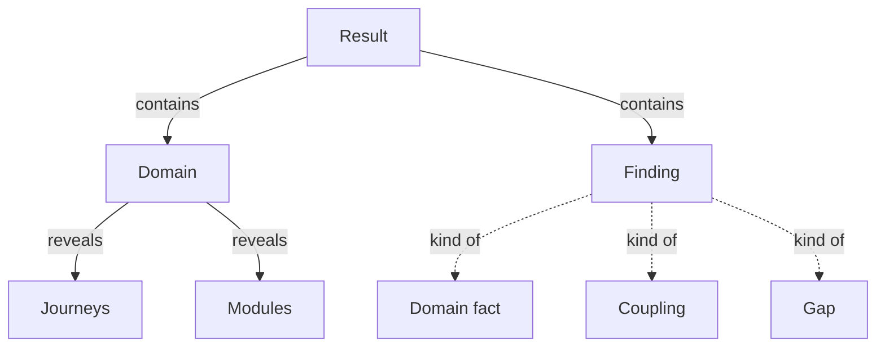

# Topology — find where each candidate sits

> **What this is** — the second lens. It takes the candidates Ontology found and **decomposes the section into a tree** — placing each candidate under the candidate it belongs to: what contains what, what is a kind of what, what reveals what.
> **What it is not** — it does not find new candidates (`lens1-ontology.md`), track how they move (`lens3-choreography.md`), or judge them (`otc-run-rules.md`). It adds no candidates; it only connects the ones already found.
> **Related docs**
>
> - `otc-methodology.md` (how the lenses connect)
> - `lens1-ontology.md`
> - `lens3-choreography.md`
> - `otc-run-rules.md`
> - words: `method-words.md`
>
> **Next step** — its tree becomes the nesting in the picture and the "Part of" line in each glossary entry.

## The mental model

Topology answers one question for every candidate: **what does it sit under?** The result is a hierarchy — a tree. Each relationship is a parent–child step: the child `contains`-into, is a `kind of`, or is `reveal`ed by its parent. Read the whole set of links together and you have the section decomposed into its structure. That tree is the entire output of this lens.

## Topology at a glance



This blows out the second lens: it begins with Ontology's flat list of candidates, arranges them into a tree, and hands that tree to Choreography.

## Input

- **Ontology's candidate table** for the section — the candidates to connect.
- **The section text** — to read the phrases between them.

## Procedure — do in order

1. **Pair up** the candidates that appear in the same sentence.
2. **Look** for a structural give-away phrase between them.
3. **Classify** it as `contains`, `kind of`, or `reveals`, and decide which candidate is the **parent** and which the **child**.
4. **Record** the relationship — `parent → child` — with the exact phrase as evidence.
5. **Stop** if there is no phrase. No phrase, no relationship — Topology never infers structure the text does not state.

## The three structural relationships

| Relationship | Parent is... | Child is... | Give-away phrases |
|---|---|---|---|
| **contains** | the whole | a part of it | "is made up of", "holds", "consists of", "carries", "its a, b and c" |
| **kind of** | the category | a member of it | "is one of", "such as", "a X — a, b, or c" |
| **reveals** | the candidate that opens | what it shows on demand | "opens to its", "shows its", "expands to" |

`reveals` differs from `contains` (composition vs showing an existing part), and both differ from Choreography's `locks / unlocks` (whether something *can happen*), which is not this lens.

## Rules this lens enforces (inline)

- Record a relationship only where a give-away phrase exists — no phrase, no relationship.
- Set the direction: the parent is the whole / category / opener; the child is the part / member / what is revealed.
- Add no new candidates — only connect the candidates Ontology found.

## Output — the levels, the kinds, and every relationship

Topology's output goes into part 2 of the section draft, "How they fit together", filled from `templates/section-glossary.md`. It shows the section's structure as [G5](glossary-assembly-principles.md#g5) sets out:

- **The tree (text tree)** - the section's candidates, names only, each under its nearest parent, as deep as it goes. The reader's quick view.
- **The level table (levels)** - the same rows, line for line, with each candidate's level in its own column (L1, L2, and so on) and its relationship to the candidate above in plain words.
- **Candidates that also belong elsewhere (lookup)** - every other parent a candidate has, with the fixed takeaways; a "kind of" relationship places a candidate only when it has no "part of" parent.
- **Every relationship, as a table (verbatim)** - the columns of that table in part 2 of `templates/section-glossary.md`, copied exactly; the Evidence cell is the exact quote from the source and where it is. Rows are grouped by parent. The source of truth, including the relationships in the lookup and shortcuts the level table does not draw.

**How to read this table (reading key):** the **parent** is the whole, the category, or the candidate that opens; the **child** is the part, the member, or what is shown. The "reads as" cell says the relationship in a plain sentence, from the fixed patterns in G5: for example, `contains` reads "Each {child} is part of a {parent}."

**Casing.** Candidates in the tree, the level table, the lookup, and the verbatim table are written in sentence case per G6 in `glossary-assembly-principles.md`, so they look exactly as they will in the glossary; relationship words stay lower case; the Evidence cell keeps the source's own casing.

## Worked example — from the real requirements

Continuing the shared section. **From Ontology** we already have the candidates — *quick scan, deep read, source, result, as-is, domain, journey, module, finding, evidence*. Topology now places them under one another, as part 2 of the section draft shows them.

> "Deep analysis ... presents its result. The result presents the as-is organised by business domain; each domain opens to its journeys and its modules. Every finding — a domain fact, a coupling, a gap — can be opened to the evidence."

**The tree (text tree)**

```
Result
├── Domain
│   ├── Journeys
│   └── Modules
└── Finding
    ├── Domain fact
    ├── Coupling
    └── Gap
```

**The picture (diagram)** - a dotted line is "kind of".



**The level table (levels)**

| L1 | L2 | L3 | Relationship to the candidate above | Kind |
|---|---|---|---|---|
| Result | | | - | object |
| | Domain | | part of a result | object |
| | | Journeys | shown when a domain is opened | object |
| | | Modules | shown when a domain is opened | object |
| | Finding | | part of a result | object |
| | | Domain fact | a kind of finding | object |
| | | Coupling | a kind of finding | object |
| | | Gap | a kind of finding | object |

No candidate here also belongs under another parent, so there is no lookup table.

**Every relationship, as a table (verbatim)**

| Parent | Relationship | Child | Reads as | Evidence |
|---|---|---|---|---|
| Result | contains | Domain | Each domain is part of a result. | "The result presents the as-is organised by business domain" |
| Result | contains | Finding | Each finding is part of a result. | "Every finding ..." |
| Domain | reveals | Journeys | Opening a domain shows its journeys. | "each domain opens to its journeys and its modules" |
| Domain | reveals | Modules | Opening a domain shows its modules. | "each domain opens to its journeys and its modules" |
| Finding | kind of | Domain fact | A domain fact is one kind of finding. | "Every finding — a domain fact, a coupling, a gap" |
| Finding | kind of | Coupling | A coupling is one kind of finding. | "Every finding — a domain fact, a coupling, a gap" |
| Finding | kind of | Gap | A gap is one kind of finding. | "Every finding — a domain fact, a coupling, a gap" |

## Relationships across sections

Structure is not confined to one section. `result contains finding` connects two different sections of the Analysis module; a relationship from `finding` to `Evidence` would reach into the Evidence module. Topology records both the same way — a give-away phrase in one sentence — and the **shared glossary** is what lets it recognise a term that first appeared in another section.

Which section each term belongs to is **not repeated in every row** — that would clutter the tree. It is recorded once, in the term's glossary entry (its `Source`), and the cross-links are joined into one whole when the section drafts are assembled in `otc-methodology.md`. Topology never invents a cross-link; it only records one the text states.

## Hand-off

The tree is handed to **Choreography**, which animates it. Its shape carries through to the picture — `contains` and `kind of` become the nesting, `reveals` an arrow — and each candidate's parent becomes the **Part of** line in its glossary entry. The entry shape lives in `output-formats.md`.
