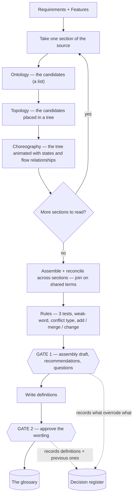

# Methodology — how the three lenses tie together

> **What this is** — the binder that ties the three lenses together: the order they run in, how each feeds the next, how they assemble into the assembly draft, and where that draft goes.
> **What it is not** — not the lenses themselves, not the law that judges terms, not the output shapes. It only connects them.
> **Related docs**
>
> - lenses:
>   - `lens1-ontology.md`
>   - `lens2-topology.md`
>   - `lens3-choreography.md`
> - law: `otc-run-rules.md`
> - shapes: `output-formats.md`
> - overview: `../glossary-design.md`
> - words: `method-words.md`
>
> **Next step** — read `lens1-ontology.md`, the first lens. The harvest and check skills apply this methodology; the disposition skill consumes its outputs.

## What the methodology is

A way to read *any* source for meaning, in three lenses — **O**ntology, **T**opology, **C**horeography — that together produce **one model** of the product's candidates and how they connect. It reads the phrases in sentences, not tables or identifiers, so it works on a tidy spec or a loose brief alike. It is **methodology, not a skill**: it describes *how to read* and produces nothing until a skill runs it; the skill adds the gates, the state, and the output files.

## Words this methodology uses

We hold ourselves to the same discipline we ask of a specification — one word per meaning.

Every word this method uses is defined once, in `method-words.md`: what it means, an example, and the words we no longer use for it. This doc uses those words and defines none of its own.

## Sections — how the source is divided

Each lens reads one **section** at a time. Take the sections from the source's **own structure** — its headings, modules, or numbered groups, in source order. That is repeatable because the divisions are the source's, not ours. If the source has no structure of its own, treat the whole source as one section, or ask the person to mark the sections at the gate — never invent a grouping of loose prose. Name and fix the sections before reading.

**Naming a section.** A section's name is its own name in the source, without the number or id the source puts in front of its section names to number them - for example E01, EP-01, or 3.2. A number that is part of the name itself stays: "Phase 2 features" keeps its 2. The section's folder name is that name in kebab-case - "E01 Checkout" becomes `checkout`, "Phase 2 features" becomes `phase-2-features` - and its files take the folder's name (`output-formats.md`, "The run root"). If two sections would get the same name, each takes the name of the source it comes from in front (`requirements-checkout`, `prototype-checkout`).

## The one principle: meaning first

The lenses run in a fixed order, each building on the one before. **Ontology** finds *what* the candidates are — a flat list. **Topology** takes that list and arranges it into a *tree* — where each candidate sits. **Choreography** takes the tree and *animates* it — the states each term can be in, and the gates between them. Each lens hands its output to the next: candidates → tree → animated tree, and that animated tree is the section draft.

## When the rules apply — inline, then over the assembly draft

Rules run at **two moments**, not one. Most run **inline, as each lens runs** — they judge a single item and need nothing else, so there is no "draft now, get scolded later". A few can only run **after the whole read**, because they need every section in view.

| Rule | Runs | Why |
|---|---|---|
| four-kinds keep drop-list evidence quote no "how" words | **inline, in Ontology** | judges one item, needs nothing else |
| no phrase → no relationship | **inline, in Topology / Choreography** | judges one sentence |
| the three tests (especially reach) | **over the assembly draft, after the read** | reach needs every section |
| the five conflict types | **over the assembly draft** | needs all candidates on the table |
| weak-word recommendation | **over the assembly draft** | names the axis across all uses |
| add / merge / change | **over the assembly draft** | needs the full set against the existing glossary |

The inline rules live in the Ontology, Topology, and Choreography docs, in each lens's **"Rules this lens enforces"** list. The rules that run over the assembly draft live in `otc-run-rules.md`. Note the second moment is **not error-hunting** — it is decision-making that needs everything visible (which word wins, is this reach-2, is this a merge); those calls simply cannot be made during a single lens. So: read each section with its local rules applied as you go, then apply the other rules once, over the assembly draft.

## The end-to-end flow

Everything inside the OTC loop is **read and assemble** — the methodology's whole job. Everything from `Rules` downward is judgment, gates, and shapes, owned by `otc-run-rules.md`, the person, and `output-formats.md`. The two gates are the only points a person decides; every decision they take is written to the **decision register**, which is what makes overrides auditable.

## The same-meaning test — why it lives here, not in a single lens

Deciding whether two words have one meaning needs all three lenses at once, so it sits in the binder rather than in any single lens. Two words are the same **only if they agree on all three**: O — described with the same meaning; T — sit in the same place, same parent and same kind; C — same states and same actions. If all three agree, the two words have one meaning, and the method **proposes the merge**: in the assembly draft the words become one box under the recommended word, with the others listed as "also written as", and a Gate 1 row asks the person to confirm it. If any disagree, they stay separate boxes and become a conflict for the gate; `otc-run-rules.md` says which conflict type it is. Either way the person decides at Gate 1 - the method recommends the winning word, it never settles it.

## Assembly — one section draft per section, then joined across sections

Because the lenses build on each other, the section draft is complete when Choreography finishes a section: **Ontology** put the boxes in (the candidates), **Topology** nested them (`contains`, `kind of`, `reveals`), and **Choreography** added the `also can be` states and the `locks / produces / comes-before` arrows. The same-meaning test proposes merging synonyms into one box with an `Also written as` line, for the person to confirm at Gate 1. The exact layout lives in `output-formats.md`; a worked example is in the design doc.

**Joining across sections.** The glossary is one shared set across every section, not per-section. So a term used in two sections is the **same node**. When section A's text links a local term to a term owned by section B (recognised as already in the shared glossary), that **cross-section link** is recorded where the phrase appears. When the section drafts are then assembled, those shared terms are the **join points** that stitch the section trees into one whole. Nothing is invented — a cross-section link exists only where a sentence states it, and the shared glossary is what lets a lens recognise a term first seen in another section.

## Re-run — the methodology never starts from zero

On a re-run, Ontology checks each candidate against the existing glossary, and the same-meaning test may find an existing term appearing under a new word. The methodology *surfaces* these; `otc-run-rules.md` classifies each as one of:

- **add**
- **merge**
- **change**
- **no change**

The person confirms at the gate, and the decision register records what overrode what. This is what stops the glossary going stale: every run is a delta against the current glossary, never a fresh pile of words.

## Where the methodology stops

| Concern | Owner |
|---|---|
| read the source, find candidates and connections, build the assembly draft | **the methodology** — this doc plus Ontology / Topology / Choreography |
| judge which candidates qualify, classify conflicts, decide add / merge / change | `otc-run-rules.md` |
| the shape of each section draft and the assembly draft, the glossary entry, the decision register, the deltas | `output-formats.md` |
| run the lenses, hold the gates, write the files, keep state | the **skills** — harvest / check / change |
| decide every conflict, keep or drop each candidate, answer each question | the **person**, at a gate |
