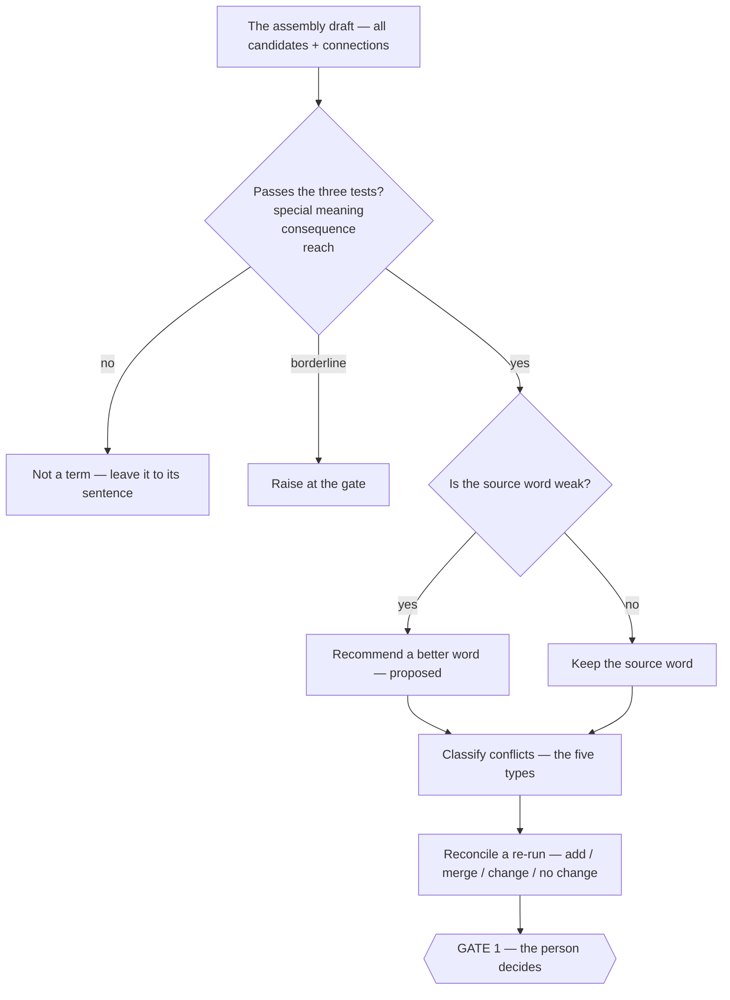

# Rules — the judgments over the assembly draft

> **What this is** — the rules that need **every section in view**: which candidates qualify, how a weak word is improved, how conflicts are classified, how a re-run is reconciled, and who decides at each gate.
> **What it is not** — the **per-item rules**, which live in the Ontology, Topology, and Choreography docs (each lens's "Rules this lens enforces" list — four-kinds, drop-list, evidence quote, no "how" words, no-phrase-no-link). This file holds only what cannot be judged during a single lens.
> **Related docs**
>
> - `otc-methodology.md` ("When the rules apply")
> - `lens1-ontology.md`
> - `lens2-topology.md`
> - `lens3-choreography.md`
> - `output-formats.md`
> - words: `method-words.md`
>
> **Next step** — its verdicts go to Gate 1 (recommendations, conflicts, questions) and, after that, Gate 2 (definitions).

## When it runs

Once, after the full OTC read, over the **whole assembly draft** — never candidate-by-candidate. Reach, conflicts, the weak-word recommendation, and the re-run all need every section in view. This is **not error-hunting on a draft** — it is the set of decisions that can only be made once everything is on the table (which word wins, is a candidate reach-2, is this a merge). The per-item rules have already been applied inline, as each lens ran.

## The judgment at a glance

## 1. The three qualifying tests

A candidate becomes a term only if **all three** hold.

| Test | The question | Passes | Fails |
|---|---|---|---|
| **special meaning** | would a newcomer take the everyday sense and be wrong? | "quick scan" — a defined first read, not a casual skim | "results" — the everyday word |
| **consequence** | would a misreading change what is built or tested? | "deep read" — a stopped scan locks it | "in depth" — a manner, changes nothing |
| **reach** | is it used in more than one section? | "source" — across Setup and Analysis | a word in a single sentence |

- **Borderline reach** (used in one section but several requirements — e.g. "gap") is **raised at the gate**, not decided here.
- A word the **source coins itself** ("call them blocks") passes *special meaning* automatically.
- Ontology cast a wide net; this test is where the net is narrowed.

## 2. The weak-word test → a recommendation

If a qualifying candidate's source word is **weak**, propose one or two better words for the gate — never a silent swap.

| Weak because | Example | Recommend |
|---|---|---|
| relative, no axis | "deep / shallow / quick" | name the axis |
| generic | "deep **analysis**" | **deep read** |
| overloaded | one word, several meanings | split or narrow |
| clashes with a standard meaning | imports the wrong sense | a distinct word |
| hard for a reader whose first language isn't English | a word on the hard words list in `../simple-writing-rules.md`, an idiom, or jargon | an everyday word, with the source's word kept as "also written as" |

**The boundary:** we may improve a **label**; we may never invent a **meaning**. The meaning is always the source's, stated back plainly.

## 3. The five conflict types

Each is surfaced with its locations and taken to the gate. The law never picks the winner.

| Type | Description | Example |
|---|---|---|
| several words, one meaning | synonyms to collapse | quick scan quick analysis the scan |
| one word, several meanings | a word to split or narrow | "source" (a repository) vs "engagement-wide sources" (reference material) |
| part vs whole | a whole confused with its part | "the read" = the whole run, or the deep read only? |
| clashes with a method word | a product word clashes with method vocabulary | product "module" (part of a domain) vs our "section" |
| drift between sources | one meaning named differently across files | EPIC "Adaptive Output" vs requirement "Case-driven output" |

## 4. Reconciling a re-run

When the glossary already exists, every candidate is classified against it:

| Outcome | Meaning | Reaches a person? |
|---|---|---|
| **add** | genuinely new — nothing covers it | yes |
| **merge** | the same meaning under a new word | the naming choice does |
| **change** | an existing term's meaning has shifted | the wording does |
| **no change** | already covered, same meaning | no — skipped |

## 5. The boundary — recommend, never decide

The law **proposes**; the person **disposes**. It surfaces qualifying candidates, weak-word recommendations, conflicts, and re-run outcomes with evidence — and then stops. It never picks a winning word, never invents a meaning, and never answers a question on the person's behalf. A merge shown in the assembly draft is such a proposal: it carries the recommended word and names the Gate 1 row that decides it, and it is changed if the person overrides it.

## 6. The gates — who decides what

| Gate | The person decides | The law must not |
|---|---|---|
| **Gate 1** — assembly draft, recommendations, conflicts, questions | • the winning word in each conflict • keep or drop each candidate • borderline-reach resolutions • the answer to each question • which groups become the families | pick a winner, resolve a conflict, or answer a question itself |
| **Gate 2** — definitions | the final wording of each entry | invent a meaning the source does not support |

**The families are always a Gate 1 row**, even when the source's structure makes the answer look obvious: one question, applying to all sections, recommending which of the source's top-level groups become the families and in what order. Its settled row in the decision register is what every glossary page links to when it explains what a family is, so a reader can always see how the families were chosen.

Gate 1 is presented in the shape `output-formats.md` sets out ("The Gate 1 review") — gate rows only, as tables, with evidence in every row and the question in its own row; never a re-dump of the assembly draft. Every decision taken at a gate is written to the decision register (`output-formats.md`), so what overrode what stays auditable.

## 7. A gate blocks until every item is resolved

When a gate is raised, its review is written to the gate log (`output-formats.md`, "The gate log"), one row per item, each starting `open`. A gate is **not passed while any of its rows is `open`**: the tool must not write definitions (past Gate 1) or write the seven glossary pages (past Gate 2) until every row is resolved — `accepted`, `overridden`, or `answered`. If the session ends with rows still open, the run resumes from those rows; the gate log, not the transcript, is the record of what still needs the person. A stop for the person that lives only in transient output is not a gate — to be one it must be durable, addressable, and blocking.

The gate is: block, confirm, move ahead. The tool presents each open gate row with its recommendation and the options; the person confirms or overrides; only then does the run move on. Where the person's intent is unclear, the tool asks one clarifying question and does not proceed on a guess. How the gate rows are presented — section by section, recommendation first, never as an open question — is in `output-formats.md` ("How the gate is answered").
