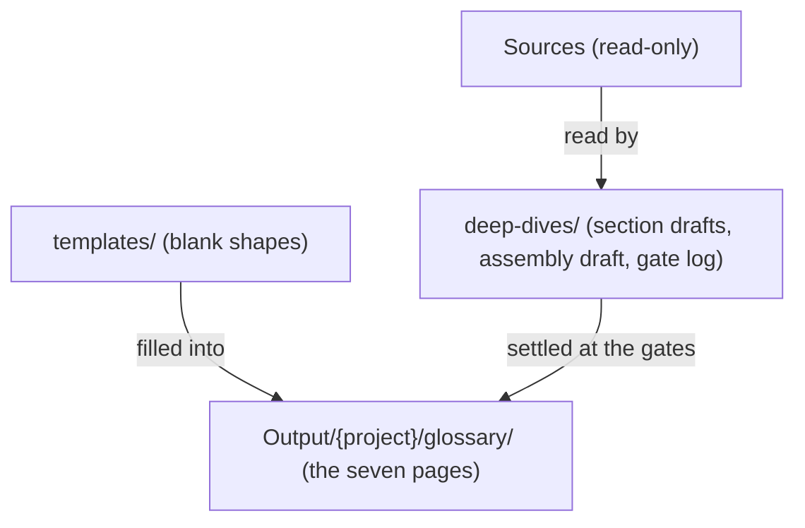
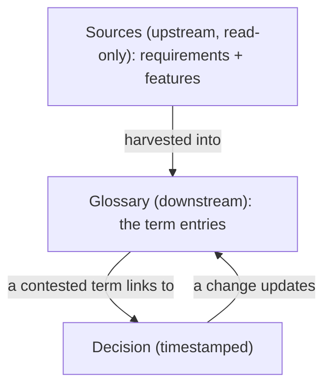

# Formats — the shape and home of every output

> **What this is** — the shape and location of everything the method writes: the glossary pages, one entry, the decision register, and how they link to the source.
> **What it is not** — the method (the lenses) or the law (`otc-run-rules.md`). This file is about shapes and homes only.
> **Related docs**
>
> - `otc-methodology.md`
> - `otc-run-rules.md`
> - blank shapes in `../templates/`
> - words: `method-words.md`
>
> **Next step** — the skills fill the templates in `../templates/` and write them to `Output/{project}/glossary/`.

## Objective

Give every output **one shape and one home**, so any run is diffable and entries, decisions, and the source stay linked. Blank versions of every page below live in **`../templates/`** — this doc shows how they are filled, with a small real example.

> **Casing.** Every page this method writes follows one casing rule, G6 in `glossary-assembly-principles.md`: terms and family names in **sentence case**, acronyms in capitals, company and product names in their own form, relationship words in lower case. That covers the seven glossary pages **and** everything in `deep-dives/` (the section drafts, the decisions files, the assembly draft, and the gate log), so a word looks the same wherever a reader meets it. Quotes from the source are never recased.

## Where everything lives — four buckets

| Bucket | Folder | What it holds | Kept? |
|---|---|---|---|
| Method | `_shared/glossary/` | how to do it — the reference docs | permanent, read-only |
| Templates | `templates/` | **blank** copies of the files a run writes | permanent, read-only |
| Glossary (the deliverable) | `Output/{project}/glossary/` — the seven pages | the **finished** glossary: where a reader looks up a term | the deliverable |
| Deep-dives (the evidence) | `Output/{project}/glossary/deep-dives/` | **how the glossary was reached**: one folder per section (its draft and its decisions file), the assembly draft, and the gate log | kept with the glossary; a re-run replaces the section drafts |

**How they relate, in one line:** you build each section's draft in its `deep-dives/{section}/` folder; at the gates, the settled terms and decisions are written into the seven glossary pages, using the blank shapes from `templates/`. The seven pages are *the result*; `deep-dives/` is *how you got there* and the proof behind every entry. A reader starts with the seven pages and opens `deep-dives/` only to check a source quote or a decision.



## The run root — where a run writes

The layout is **fixed**: nothing in it is chosen per run, per client, or per subject. A project has **one glossary**, in `Output/{project}/glossary/`, the Glossary's folder in `project-folders.md`. When the source produces several glossaries, each becomes a project of its own, settled at the scaffolding step before any reading, and the person supplies and confirms each project's name. File names always derive from folder names: `{section}/` holds `{section}-glossary.md` and `{section}-decisions.md`. A `{section}` folder name is the section's own name in kebab-case, never carrying the number or id the source puts in front of it (`otc-methodology.md`, "Naming a section"): `checkout/`, not `e01-checkout/`.

| Glossaries | Layout |
|---|---|
| one | `Output/{project}/glossary/` — the seven pages, with `deep-dives/` inside it |
| several | one project for each glossary, each with `Output/{project}/glossary/` — the same layout under each project |

### Example — one glossary

```
Output/
└── glossary/
    ├── README.md
    ├── terms-and-relationships.md
    ├── object-terms.md
    ├── role-terms.md
    ├── step-terms.md
    ├── states-and-values.md
    ├── decision-register.md
    └── deep-dives/
        ├── gate-log.md
        ├── glossary-assembly-draft.md
        ├── {section-1}/
        │   ├── {section-1}-glossary.md
        │   └── {section-1}-decisions.md
        └── {section-2}/
            ├── {section-2}-glossary.md
            └── {section-2}-decisions.md
```

### Example — several glossaries

Each glossary is its own project; below the project's name the tree is identical to the one-glossary case.

```
Output/
├── {project-1}/
│   └── glossary/
│       ├── README.md
│       ├── ... (the other six files)
│       └── deep-dives/
│           ├── gate-log.md
│           ├── glossary-assembly-draft.md
│           └── {section-n}/
│               ├── {section-n}-glossary.md
│               └── {section-n}-decisions.md
└── {project-2}/
    └── glossary/
        ├── README.md
        ├── ... (the other six files)
        └── deep-dives/
            └── (same as above)
```

### What a run finds, and what it does

A run decides what it is facing by looking for the **seven glossary pages**, never by whether the folder is empty — `deep-dives/` fills up long before the seven pages exist, so a folder test would mistake an unfinished run for a finished one.

| What is found | Mode | What happens |
|---|---|---|
| no `Output/{project}/glossary/` | **new build** | start from the beginning |
| `deep-dives/` exists, but not the seven pages | **resumed build** | an earlier run stopped part-way; continue from the `open` rows in `deep-dives/gate-log.md` |
| all seven pages | **re-run** | read the source again and compare against the existing glossary (add / merge / change / no change). If `deep-dives/` is missing — for example a glossary built before this layout — say so and start a fresh one; the decision register still holds the history |

**On a re-run**, each new section draft replaces the old one in `deep-dives/{section}/`. The gate log and the decision register are never overwritten: the re-run adds a new part to the gate log and new rows to the register, so the full history stays. Before a section folder the source no longer has is removed, the person is asked.

## The output — the glossary pages

The deliverable in `Output/{project}/glossary/`, each page a filled copy of its `templates/` blank:

```
Output/{project}/glossary/
├── README.md                    the gateway: purpose, sources, reading order
├── terms-and-relationships.md   the joined view: the object hierarchy
├── object-terms.md              object terms
├── role-terms.md                role terms
├── step-terms.md                step terms
├── states-and-values.md         state and value terms
├── decision-register.md         the decision register - one file, keyed by decision id
└── deep-dives/                  how the glossary was reached (see "The deep-dives")
```

When this method says "the seven pages", it means the seven above, not `deep-dives/`. The check and disposition skills read only the seven pages.

## A glossary entry

The reader-facing entry shape is defined in `glossary-assembly-principles.md`, not here: the columns each kind uses are set in that kind's Part B rules and written in its template in `templates/`, cased per G6. This file governs the deep-dives, the run root, the decision register, and the gate log; it does not fix the deliverable's entry table.

## The decision register — one file, keyed by decision id

Every gate decision is one row in a single `decision-register.md`, keyed by a global id `D-1`, `D-2`, ..., append-only. It records *what was settled*: why a term has the word it has, and *what overrode what*. It does **not** depend on feature numbers: the **Where** column holds the section the term was found in, plus its feature id only if the source has one. The **Gate row** column links to the gate-log row where the decision was taken, so a reader can follow it back to the evidence and the options.

**Generated, never written by hand.** `build-glossary-records.ts` writes the register from the gate log: one row for each resolved gate-log row, in the log's order, so the same log always gives the same register.

**Example — `decision-register.md`:**

| ID | Term | Where | Decided | Chosen | Retired / overrides | Basis | Gate row | Date |
|---|---|---|---|---|---|---|---|---|
| D-1 | Quick scan | Analysis (F-21) | the name of the first read | Quick scan | retired: quick analysis, the scan | source title; pairs with "deep read" | G1-04 | 2026-09-28 |
| D-2 | Section | Methodology | the word for the reading unit | Section | retired: module, area, slice | agnostic; avoids the product-term clash | G1-07 | 2026-09-28 |

- **Timestamped** — every row carries its date.
- **No feature number needed** — *Where* falls back to the section, which always exists. D-2 above comes from a source with no features and is filed the same way.
- **A change** is a new row in the gate log's Change part. When `build-glossary-records.ts` runs again, the register gains its row, whose **Retired / overrides** cell names the earlier word and the decision it reverses. The term's entry changes as "Changing a term" below sets out.

## Where each decision is recorded — one home for each fact

A decision is written in **one place only: the gate log**. Every other place that shows it is filled from the gate log by a program, so nothing is written twice and no two places can disagree. Each record links to the next.

| File | Answers the question | Holds | Written by |
|---|---|---|---|
| `deep-dives/gate-log.md` | **How was it decided?** | every item raised at a gate — the evidence, the options, the recommendation, and the person's resolution, with its date. Nothing is ever deleted. | harvest at Gate 1 and Gate 2; disposition for later changes. The only place a decision is written. |
| `decision-register.md` | **What was settled?** | one row per settled decision, `D-n`, with a link back to its gate-log row | `build-glossary-records.ts`, from the gate log |
| `deep-dives/{section}/{section}-decisions.md` | **What happened to this section's words?** | one row per candidate in that section's draft: kept, renamed, merged, dropped, or pending, with the word now used in the glossary and a link to the `D-n` row | `build-glossary-records.ts`, from the gate log and the section's draft |
| Gate 2's **Also written as**, in the gate log | **Which other words did the sources use for this term?** | the words Gate 1 merged into the term, or replaced with it | `fill-also-written-as.ts`, from the settled Gate 1 rows, before Gate 2 is shown |
| each kind page's **Terms replaced or retired over time** | **What should I use instead of this earlier word?** | every earlier word of that kind, with the term to use now ([G8](glossary-assembly-principles.md#g8)) | `build-retired-words-tables.ts`, from the gate log |

Read it plainly: the gate log is the full story, the register is the verdict, and a section's decisions file translates that section's words into the glossary's words.

None of these is edited by hand. When the gate log changes, the programs run again: harvest runs them after writing the glossary, and disposition after every change.

## Changing a term — what each change does to the entry

A term's row in its kind page always shows the current word and the current definition. Nothing is deleted: an earlier word moves to that page's **Terms replaced or retired over time** table ([G8](glossary-assembly-principles.md#g8)), and earlier wording stays in the gate log and the register.

| Change | Effect on the entry |
|---|---|
| rename | the row shows the new word, meaning unchanged; the old word gets a row in Terms replaced or retired over time, with What happened `renamed` |
| redefine | the row's What it is shows the new definition; the old wording is quoted in the change row of the gate log and noted in the register row's Basis; the term keeps its name, so it gets no history row |
| split | the row becomes two rows, each with its own What it is and Relationship to the term above; the old word gets a history row, What happened `split`, with both new terms in Use now |
| withdraw | the row leaves its table and the word gets a history row, What happened `withdrawn`, Use now `-` |
| merge | the merged term's row goes; the term it merged into keeps its row; the merged word gets a history row, What happened `merged` |

Every change is also a row in the gate log's Change part. When the programs run again, the decision register gains its timestamped row, its **Retired / overrides** cell naming the earlier word and the decision it reverses, and its **Gate row** linking to the change row in the gate log; the term's earlier word gains its row in Terms replaced or retired over time.

## How the three link — source is upstream, glossary is downstream



Read it plainly: the source flows **down** into the glossary; a contested entry points to the decision that settled it; and a later decision flows a change back into the entry. The source is never written to.

## The deep-dives — how the glossary was reached

`Output/{project}/glossary/deep-dives/` holds everything a run produces on the way to the glossary. It is **kept** with the glossary as its evidence: a reader, or a later analysis, opens it to see the source's own words behind an entry and how each decision was taken. Files are named by their section, so a tab is self-identifying — never a bare `picture.md`.

| File | Holds |
|---|---|
| `deep-dives/{section}/{section}-glossary.md` | the section's draft — its candidates, tree, and gates, built across the three lenses. It keeps the **source's own words** after the gates, because it is the evidence; the decisions file beside it gives the glossary's word for each |
| `deep-dives/{section}/{section}-decisions.md` | what the gates did to this section's words (shape below) |
| `deep-dives/glossary-assembly-draft.md` | the assembly draft, joining all section drafts |
| `deep-dives/gate-log.md` | every gate row and how it was decided (see "The gate log") |

Example: `deep-dives/analysis/analysis-glossary.md`.

### What the section decisions file must contain

`{section}-decisions.md` is written by `build-glossary-records.ts` once the gates are passed, from the gate log and the section's draft; until then it holds its opening, one line - `None yet - written once the gates are passed.` - and its related pages. It has one table, with one row for **every** candidate in the section's draft, in the draft's order:

| Column | Holds |
|---|---|
| Candidate in this draft | the word exactly as this section's draft has it |
| Outcome | one of:<br>• `kept`<br>• `renamed`<br>• `merged`<br>• `dropped`<br>• `pending` |
| In the glossary | the word the glossary now uses; `-` when dropped |
| Decision | a link to the register row, `[D-n](../../decision-register.md#d-n)`; or the test it failed, when it was dropped without a gate row (for example `failed reach`); or `-` when it was kept unchanged without a contest |

The file opens with one plain line saying what it is: "What the gates did to the words in this section's draft. The draft keeps the source's words; this table gives the glossary's word for each, and the decision behind it." It ends with **Related pages** ([G7](glossary-assembly-principles.md#g7)), always these three:
- the section's draft, `{section}-glossary.md`
- `decision-register.md`
- `deep-dives/gate-log.md`

A blank shape is in `templates/section-decisions.md`.

### What the section draft must contain

`deep-dives/{section}/{section}-glossary.md` is one section of the source, read through the three lenses. It is written by filling `templates/section-glossary.md`, and kept as the evidence behind every glossary entry from this section. It contains exactly this, in this order:

| Part | Holds |
|---|---|
| Opening | • the title `Section draft - {section name}`<br>• one paragraph: which part of the source this is, and what the page holds<br>• the source it was read from: file, sheet or heading, and item ids<br>• **Contents**, each part a link<br>• **How to read this page**: one line linking to the fixed block in `README.md`, then the columns and relationship words this page uses |
| 1. The candidates found (ontology) | one table per kind, each candidate with its meaning and an exact quote:<br>• objects<br>• roles<br>• steps<br>• states and values |
| 2. How they fit together (topology) | • the tree<br>• the picture<br>• the level table<br>• candidates that also belong elsewhere<br>• every relationship, as a table, with "reads as" and the quote that states it |
| 3. How they move (choreography) | • the states each candidate can be in<br>• the flow, step by step<br>• every flow relationship, as a table, with "reads as" and the quote<br>• the picture |
| 4. Conflicts noticed in this section | words that look like several names for one meaning, or one word with several meanings, within this section only - for the assembly to weigh across sections |
| 5. Words dropped | phrases dropped while reading, with the DROP-list reason from `lens1-ontology.md` |
| Related pages | always these three ([G7](glossary-assembly-principles.md#g7)):<br>• the section's decisions file<br>• the assembly draft<br>• the gate log |

The draft follows [G4](glossary-assembly-principles.md#g4) - each numbered part opens with the four-line explainer, each table, tree, and picture inside it with one plain line - and [G5](glossary-assembly-principles.md#g5): placement, the level table (`L1 | ... | Ln | Relationship to the candidate above | Kind`, with no home-family column, since a section draft is one section), the lookup with its fixed takeaways, and a picture of the section alone. A draft missing any part is incomplete.

**Casing and naming, in every draft and in the assembly draft:**
- Candidates are cased per G6 in `glossary-assembly-principles.md`, in tables, trees and picture labels alike, so a word looks the same here as in the seven glossary pages. Quotes stay exactly as the source has them.
- A section is never shortened to a code. Where a draft must name a section, it writes the section's folder name as a link.
- Level and relationship rows carry no column listing the sections a relationship appears in; which section a term comes from is recorded once, in the term's source (`lens2-topology.md`, "Relationships across sections").

### What the assembly draft must contain

`deep-dives/glossary-assembly-draft.md` is the assembly draft of the whole source: the section drafts put together, so a candidate several sections use appears once. It is written before Gate 1 by filling `templates/glossary-assembly-draft.md`, and kept afterwards as evidence. It holds **no decisions** — every question it raises is a row in the gate log.

It contains exactly this, in this order, and nothing else:

| Part | Holds | Used after the gates to build |
|---|---|---|
| Opening | • a status line, always the same: "Proposed before Gate 1. The outcomes are in the gate log."<br>• one paragraph on what the page is<br>• the sections joined, as links to their folders<br>• **Contents**, each part a link<br>• **How to read this page**: one line linking to the fixed block in `README.md`, then the columns and relationship words this page uses | - |
| 1. The joined hierarchy | • the joined level table - the section draft's level table, joined across sections - with a proposed merge written in its row<br>• candidates that also belong elsewhere, with the fixed takeaways<br>• the proposed merges<br>• candidates not placed in the hierarchy | • the hierarchy, the lookup, and the family views in `terms-and-relationships.md`<br>• the groups in `object-terms.md` |
| 2. The joined flow | • the flow, step by step<br>• every flow relationship, as a table, with "reads as"<br>• the picture<br>• the states each candidate can be in | • the flow in `step-terms.md`<br>• `states-and-values.md` |
| 3. Candidates dropped, and why | each candidate that failed one of the three tests, with its section, the test it failed, and a one-line reason with a quote | the `dropped` rows in each section's decisions file |
| Related pages | always these three ([G7](glossary-assembly-principles.md#g7)):<br>• the gate log<br>• the section drafts<br>• `terms-and-relationships.md` | - |

The file follows [G4](glossary-assembly-principles.md#g4) and [G5](glossary-assembly-principles.md#g5): each numbered part opens with the four-line explainer - **What you're reading**, **Why it matters**, **What to do with it**, **What it affects** - and each table and picture inside it with one plain line. Families are not chosen until Gate 1, so the assembly draft has no family views and no home-family column, and it draws no picture of the whole hierarchy.

**Not allowed in the assembly draft**, because each is either a copy of something kept elsewhere or not part of the method:
- a table of section codes, or any short code for a section
- a table of sections or features that overlap
- a table of join points - a candidate shared by sections is one row in the joined hierarchy, which already shows the join
- a list of terms that passed cleanly - they come back as Gate 2 rows, with their definitions
- weak words, conflicts, questions, or any other gate row - their only home is the gate log

**Proposed merges.** Where sections use several words for what the same-meaning test (`otc-methodology.md`) finds to be one meaning, the draft shows **one row**, labelled with the recommended word and the others after it: `Cart (also written as: basket)`. The merge is a **proposal**: the proposed-merges table lists each one with the gate-log row that decides it, and the person confirms or overrides it at Gate 1. The draft is never changed after Gate 1: each outcome is in the gate log, so the draft never shows a resolution the person did not give.

## The Gate 1 review — what a person is shown

Gate 1 shows **only what needs a decision** — never a re-listing of the assembly draft (repeating it is noise). Clean candidates simply pass and are not shown. The items fall into four tables, always in this order:

| Table | Holds | What the person decides |
|---|---|---|
| **Conflicts** | one meaning with several names (including every proposed merge in the assembly draft), or one word with several meanings - one of the five conflict types in `otc-run-rules.md` | which word the glossary uses, or whether two words have one meaning |
| **Weak words** | a word the source uses that is relative, generic, overloaded, or clashes with a standard meaning | take the replacement, or keep the source's word |
| **Candidates to judge** | a candidate with borderline reach, or one we propose that the source does not name | keep it or drop it |
| **Questions** | something the source does not settle - an abbreviation it never spells out, two sources that contradict each other | the answer |

**Every row uses the same columns.** Five of them are the first five fields of "How the gate is answered" below, under exactly the same names, so the page reads like the item shown inline. The sixth field, **Left to clear**, only tells the person how far through they are, so it is shown inline and never written to the file:

`# | Applies to | The question | Why you're seeing it - evidence | Recommended, and why | Options | What changes if you take it | Status | Resolution | Decided`

**A worked row** (a conflict, from an online store):

| # | Applies to | The question | Why you're seeing it - evidence | Recommended, and why | Options | What changes if you take it | Status | Resolution | Decided |
|---|---|---|---|---|---|---|---|---|---|
| G1-03 | All sections | Do "cart" and "basket" have the same meaning, and if so, which word should the glossary use? | • [checkout](checkout/): "items stay in the cart until payment"<br>• [catalogue](catalogue/): "add the item to your basket"<br>• both hold items a shopper means to buy, sit under the shopper, and empty at payment, so the same-meaning test finds one meaning | **Yes, one term: use "Cart".** The checkout section, which defines how it behaves, uses "cart" throughout. | • (a) one term, called Cart<br>• (b) one term, called Basket<br>• (c) two different terms | • (a) "Basket" is retired; the catalogue section's decisions file shows "Basket: merged into Cart"<br>• (b) the same, the other way round<br>• (c) both stay as separate terms, each needing its own definition | open | | |

**Rules for writing a row, so it can be answered without opening anything else:**
- **The question stands on its own.** One plain sentence, ending in a question mark, that names the words involved. Never "see above", never a bare row number: if it depends on another row, name that row **and** what it settled.
- **Evidence, not verdict.** Every row quotes the source and names the section it came from, as a link.
- **Commit the recommendation.** Name the exact word, keep or drop, or answer - never "one word (e.g. ...)" - and say why in one sentence.
- **Options are labelled** (a), (b), (c), so the person picks rather than composes.
- **What changes is concrete.** Say which words retire and what is renamed, for each option where they differ.
- **No codes, no shorthand.** Sections are links; terms are spelled out and cased per G6; several items go one per line (G6).
- **No re-dump.** Candidates that pass cleanly are not listed.

## The gate log — the durable, blocking record of a gate

The Gate review above is what a person is *shown*; the **gate log** is what is *kept*. A gate that lives only in the transcript scrolls away, cannot be reopened, and can be half-answered without anyone noticing. The gate log fixes that: it is written the moment a gate is raised, so what the person must act on becomes the most durable artifact in the run, not the least.

**Home.** `deep-dives/gate-log.md`, one per glossary (see "The run root"). It is **kept** with the glossary: it is the full story of how every decision was taken. It is the only place the gate rows are written — the assembly draft does not carry a copy.

**Shape.** One page, filled from `templates/gate-log.md`. It opens with what the page is, how to read it, and how to answer. Then a part per gate: `Gate 1`, `Gate 2`, and one `Change - {date}` part each time disposition changes the glossary later; a re-run adds its own `Re-run - {date}` part. A `Change` part has one table with the Gate 1 columns, its rows numbered `CH-01` onwards. A `Re-run` part repeats the four Gate 1 tables and the Gate 2 table, with the same columns, its row ids continuing the Gate 1 and Gate 2 numbering. Later parts go above the footer, which is always **Related pages** ([G7](glossary-assembly-principles.md#g7)) with these two:
- `decision-register.md`
- `deep-dives/glossary-assembly-draft.md`

**Every part and every table opens with the four-line explainer** of [G4](glossary-assembly-principles.md#g4), so a reader who opens the page cold knows what to do:
- **What you're reading** - what sort of item the part or table holds, in everyday words.
- **Why it matters** - what the reader's answers settle.
- **What to do with it** - what the reader is expected to do.
- **What it affects** - what the answers lead to, and what changes if one is wrong.

The Gate 1 tables use the columns set out in "The Gate 1 review" above; the Gate 2 table uses `# | Applies to | Term | Kind | Proposed definition | Also written as | Source | Status | Resolution | Decided`. Among those columns, these carry the gate's bookkeeping:

| Column | Holds |
|---|---|
| # | the row's id, with a hidden anchor so the register's **Gate row** link lands on it (`<a id="g1-01"></a>G1-01`): `G1-01`, `G1-02` ... for Gate 1; `G2-001` ... for Gate 2; `CH-01` ... in a Change part; a Re-run part continues the Gate 1 and Gate 2 numbering |
| Applies to | the section the item belongs to, written as a link to its folder (for example `[checkout](checkout/)`); or **All sections** when no single section owns it — for example which source wins when the sources disagree. Never a short code |
| Status | `open` when raised, then `accepted` (recommendation taken), `overridden` (person chose otherwise), or `answered` (a question) |
| Resolution | the answer, written so a program can read it — blank while `open`:<br>• in Conflicts, Weak words and a Change part: the word the glossary uses, then one line for each word it replaces, in one of four forms: `{earlier word}: renamed to {term}`, `{earlier word}: merged into {term}`, `{earlier word}: split into {term} and {term}`, or `{earlier word}: withdrawn`<br>• in Candidates to judge: `keep` or `drop`<br>• in Questions: the answer<br>• in Gate 2: `approved`, or the definition as edited |
| Decided | the date the row resolved — blank while `open` |

Every row starts `open`. The person's decisions fill Status, Resolution, and Decided; nothing is deleted, so the log also shows what was decided and when.

**Relationship to the register.** The gate log carries the **open** state the decision register never will. Once every row is resolved, each settled outcome becomes a row in `decision-register.md`, linking back by its `#`; the register stays settled-only and append-only. Each section's decisions file is then written from the register (see "Where each decision is recorded"). The gate log is the full story; the register is the verdict.

**Blocking and resume.** A gate is not passed while any row is `open`, and the run resumes from those rows if the session ends; the law is in `otc-run-rules.md` ("The gates — who decides what"). The gate log, not the transcript, is where "what still needs me" is found.

## How the gate is answered — section by section

The gate blocks, but it must be easy to answer well. The person is taken **one item at a time, one section at a time** — never the whole gate at once, and never a bare "pick one". probing-questions-author asks each item, in its Ask mode (`../decision-review-gates.md`, rule 4). Every item has all six fields below. They are what probing-questions-author asks from: the evidence gives "What I found", and what changes gives "Why it matters" and each choice's outcome.

| Field | What it gives the person | Fixed content |
|---|---|---|
| **The question** | what must be settled | one plain sentence, ending in a question mark, naming the choice |
| **Why you're seeing it - evidence** | the reason it is a question | the evidence, quoted from the source — where each word or term appears, and what makes it a conflict, a weak word, or borderline. Evidence, never a bare verdict |
| **Recommended, and why** | the call and its reasoning | the word to pick, keep or drop, or the replacement, plus the reason (reach across sections, the source's own coinage, the axis a weak word is missing). This is the default; a plain "yes" takes it |
| **Options** | the choices | each labelled, so the person selects rather than composes |
| **What changes if you take it** | the downstream cost, before the resolution | the effect on the glossary (which words retire, what is renamed or redefined) and the ripple to documents that use the term; where an alternative costs differently, say so |
| **Left to clear** | where the person is | item i of n in this section, and rows still open across the run |

**Surface.** The gate is answered **inline** — presented and replied to in the conversation, item by item. The durable record is the gate log file (`gate-log.md`), never the transcript; the inline exchange is only how the person works through it, and the page is what a resumed run reads. Where a fuller view helps, the same gate log may be opened as a document, but the page stays the record and inline stays the default.

The person confirms the recommendation or names another option; where the choice is unclear, the tool asks one clarifying question and does not move on until it is answered. Recording each resolved item to the gate log is implicit — it is not narrated back on every item; what the person is shown is the why and the impact, not the bookkeeping.

A section is done when its rows are all resolved; the run is past the gate only when every section's rows are resolved (`otc-run-rules.md`, "A gate blocks until every item is resolved").

## The check findings and the ripple list

Both are shown to the person in the conversation, and both are filled from a template, so every run shows the same table. Inside a change, the check findings are also saved as the change's Check findings, `Output/{project}/changes/{change}/check-findings.md`, so the next step reads them; the ripple list is never written to a file.

- **Check findings** - what check found when it measured a document against the glossary, handed to disposition. Filled from `templates/check-findings.md`. Check recommends; it never applies.
  - **Issue** is one of the four problems check looks for:
    - a retired word in use
    - a term used against its definition
    - a product word with no entry
    - two words for one meaning
  - **Recommended Next Best Action** starts with one of the three next best actions disposition can take, in bold:
    - Fix the document
    - Change the glossary
    - Add the term through harvest

    Then it gives the word or wording to use, and why, and ends with `Affected file: {file name}`, the file the fix is written into. A document from outside is never edited: for Fix the document, the fix lands in section 5 of the Change impact report, the change's restatement, and then in the documents the recommendation names.
  - **Source** is the document the words were found in, so each finding can be traced back to it.
- **Ripple list** - after disposition changes a term, every line in the documents that still uses the earlier word or the old meaning. Filled from `templates/change-ripple.md`. Disposition reports it; it never edits those documents.

**Re-run delta** (the glossary already exists): each candidate is `add`, `merge`, `change`, or `no change` (defined in `otc-run-rules.md`); it is carried by the Re-run column of each section draft and the Re-run part of the gate log.
