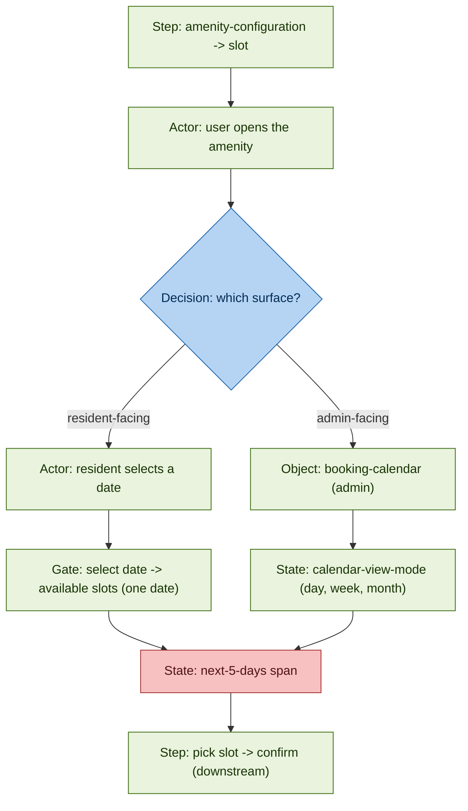
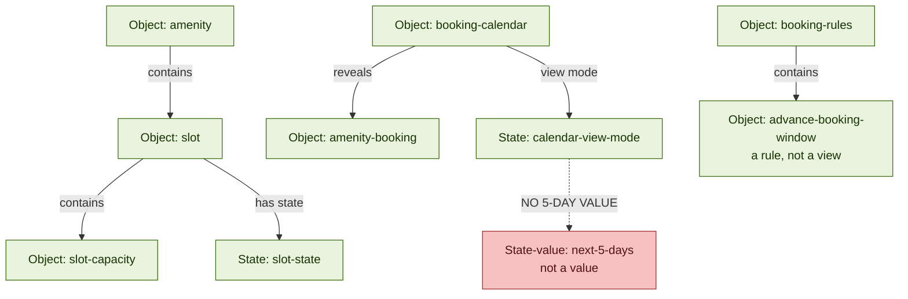

# Feature fit - "Show booking slots for the next 5 days"

> Sample output for a fictional product called Acme. The citations are illustrative; they point at a sample Acme glossary, not a real one.

- Date: 2026-10-05
- Glossary: unset (Residential or Commercial)
- Family: `amenities-facilities-and-bookings`

> Convention:
> - glossary terms and values are in pills
> - file names are in italics
> - kinds are tagged in [square brackets]

---

## How this was read - the four layers

| Layer | What it unravels | How it helps |
|---|---|---|
| Layer 1 - Family | which part of the product this belongs to | narrows the search to one family, so you do not read the whole glossary |
| Layer 2 - Term and kind | the agreed word, and whether it is an object, role, step or state | gives the exact word to match, and points to the right document |
| Layer 3 - Structure and movement | how the term connects, and the step-by-step flow with its gates | shows whether the feature can reuse existing rails, and where it plugs in |
| Layer 4 - Proof and close calls | the exact quotes, the LOB differences, the reuse-vs-missing call | lets you cite every claim and settle the tricky calls honestly |

---

## Files this view drew on

### Layer 1 - Family

| File | What it gave |
|---|---|
| *residential/map.md* | the families overview; the cross-cutting check for the 5-day span |

### Layer 2 - Term and kind

| File | What it gave |
|---|---|
| *residential/objects.md* | `amenity` `slot` `slot-capacity` `booking-calendar` `booking-rules` `advance-booking-window` |
| *residential/states.md* | `slot-state` `calendar-view-mode` |
| *residential/decisions.md* | D-3 (`slot` canonical, `booking-slot` retired) D-1 (two LOBs) |

### Layer 3 - Structure and movement

| File | What it gave |
|---|---|
| *residential/steps.md* | `amenity-configuration` -> `slot` `resident-booking-flow` |

### Layer 4 - Proof and close calls

| File | What it gave |
|---|---|
| *residential/section-deep-dives/amenities-facilities-and-bookings-glossary.md* | the "select date -> available slots" gate; booker persona drift |
| *commercial/section-deep-dives/amenities-facilities-and-bookings-glossary.md* | Slot Management and real-time availability; commercial roles |

---

## Verdict - Extend (small)

Showing bookable slots and their availability is fully modelled today. The only net-new piece is the "next 5 days" span, a display window that is not one of the existing views. This is a small extension on an existing surface, not a new build.

**At a glance**

- Reuse: 6 elements (see table)
- Net-new: 1 element (the 5-day span)
- Decisions that block: 2 (surface, LOB)

**Reuse - already in the glossary**

| Concept | Kind | Residential | Commercial |
|---|---|---|---|
| bookable time window | Object | `slot` | `slot` |
| slot availability | State | `slot-state` | `slot-state` |
| show slots for a date | Gate | select date -> available slots | real-time availability |
| admin booking calendar | Object | `booking-calendar` | `booking-calendar` |
| calendar view options | State | `calendar-view-mode` | day, week, month view |
| booking flow | Step | `resident-booking-flow` | Amenity Booking Flow |

**Net-new - the build**

| Net-new element | Kind | Why it is new |
|---|---|---|
| 5-day display span | State (value) | `calendar-view-mode` offers only day, week or month; no 5-day value |

**Decisions that block**

- Surface: resident-facing view, or admin calendar
- LOB: Residential, or Commercial

---

## Diagram 1 - Movement (how the feature would flow)

**Colours**

- Green: already in the glossary (reuse)
- Red: not in the glossary (new)
- Blue: a decision you must make

**Read it:** the whole flow is green. Slots exist, availability is shown, picking and confirming already work. The only red node is the 5-day span. Both surfaces already show slots; the delta is the window.

---

## Diagram 2 - Model (what the analysis found in the term graph)

**Read it:** `slot` and `slot-state` carry the "what to show". The display window lives on `calendar-view-mode`; the dashed edge is the missing 5-day value. `advance-booking-window` looks related but is a booking rule (how far ahead you may book), not a display span.

**Values referenced**

- `slot-state` [State] values:
  - `available`
  - `fully-booked`
  - `blocked`
  - `soft-held`
  - `released`
- `calendar-view-mode` [State] values:
  - `day`
  - `week`
  - `month`

---

## Who acts (roles)

| Step | Who | Kind | Source |
|---|---|---|---|
| Configure the amenity and its slots | `facility-booking-administrator` (Res), `asset-admin` (Com) | Role | residential bookings deep-dive, commercial bookings deep-dive |
| View and book slots | `resident` (Res), `employee` / `tenant-admin` / user (Com) | Role | residential bookings deep-dive, commercial bookings deep-dive |
| View all bookings on the calendar | `facility-booking-administrator`, `asset-admin` | Role | residential bookings deep-dive |

No new role is needed; the actors already exist.

---

## Steps followed (the operation trace)

**Decomposed tokens**

- booking slot
- show
- next 5 days

**Token: booking slot**

| Input | What you did | Processing | Output |
|---|---|---|---|
| booking slot | pick the Glossary | feature names no LOB; look at the LOB folders *residential* and *commercial* | unset -> carry both (open question) |
| booking slot | find the Family | scan "Families at a glance" in *objects.md* | Family = `amenities-facilities-and-bookings` (root term `amenity`) |
| booking slot | decide the Kind | thing or noun -> Object | document = *objects.md* |
| booking slot | match - rung 1 (exact) | search *objects.md* for "booking slot" | no head term |
| booking slot | match - rung 2 (synonym) | search *decisions.md* for "booking-slot" | D-3: `booking-slot` retired -> `slot` |
| result | - | - | REUSE Object `slot` |

**Token: show**

| Input | What you did | Processing | Output |
|---|---|---|---|
| show | reuse the Family | already fixed | `amenities-facilities-and-bookings` |
| show | decide the Kind | action and status -> Step and State | *steps.md*, *states.md* |
| show slots | match - rung 3 (value) | search *states.md* for a slot value-set | `slot-state` |
| show slots for a date | match - rung 4 (gate) | the section deep-dive, Choreography and Gates | "select date -> available time slots" |
| result | - | - | REUSE State `slot-state` plus the display Gate |

**Token: next 5 days**

| Input | What you did | Processing | Output |
|---|---|---|---|
| next 5 days | decide the Kind | range or constraint -> State (value) | *states.md* |
| next 5 days | match - rung 3 (value) | search *states.md* for a range value-set | `calendar-view-mode` = day, week, month; no 5-day |
| next 5 days | check the nearest rule | search *objects.md* `booking-rules` | `advance-booking-window` (a rule, not a view) |
| next 5 days | match - rung 5 (cross-cutting) | check the cross-cutting list in *map.md* | not present |
| result | - | - | GAP |

---

## Evidence and traceability (appendix)

| Claim | Element | Kind | Source |
|---|---|---|---|
| "booking slot" is the term `slot`; `booking-slot` retired | `slot` (D-3) | Object, Decision | objects.md, decisions.md |
| slots carry an availability state | `slot-state` | State | states.md |
| slots are shown for a chosen date | select date -> available time slots | Gate | residential bookings deep-dive |
| the resident booking flow exists | `resident-booking-flow` | Step | steps.md |
| slots are generated on config | `amenity-configuration` -> `slot` | Step | steps.md |
| admin calendar reveals bookings | `booking-calendar` reveals `amenity-booking` | Object, Relationship | objects.md |
| calendar views are day, week, month | `calendar-view-mode` | State | states.md |
| advance window is a rule, not a view | `advance-booking-window` in `booking-rules` | Object | objects.md |
| Commercial has real-time availability | Slot Management sub-module | Step (Com) | commercial bookings deep-dive |
| booker persona differs by LOB | `resident` vs `employee` / `tenant-admin` / user | Role | residential bookings deep-dive |
| two LOBs kept separate | D-1 | Decision | decisions.md |
