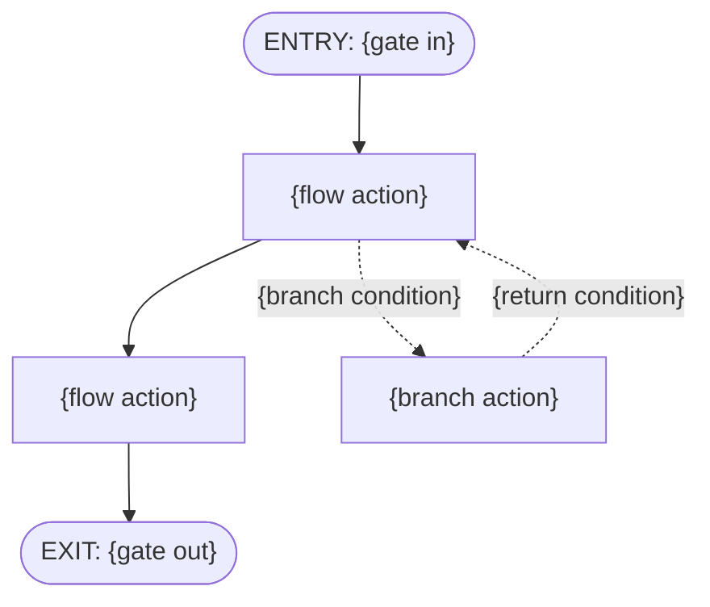

# {FRD ID} {capability name}

Status: drafted

- **Depends on:** the features outside this capability that its features need first, as the catalog's "Depends on" lists them
  - {feature ID} {feature name}
- **Last changed:** {last changed}
- **Excludes:** every other feature in the same section of the catalog, in ID order, then any feature or section this FRD's own requirements name
  - {feature ID} {feature name}
  - {feature ID} {feature name}, linked by {requirement ID}

**Requirements**

- **{requirement ID} {requirement title}** — {requirement text}

## Features covered

| Feature ID | Feature | Description | Req. ID | Priority |
|---|---|---|---|---|
| {feature ID} | {feature name} | {description} | {requirement ID} | {priority} |

## Gates

| | Condition | Tied to |
|---|---|---|
| **In** (true before start) | {gate in} | {gate in features} |
| **Out** (this unlocks) | {gate out} | {gate out features} |
| **Undone if** | {undone if} | {undone by} |

## Actors

| Actor | What they do in this capability |
|---|---|
| {actor} | • {action} • {action} |

## Rules

### {feature ID} {feature name}

| Rule | The system shall… | Source |
|---|---|---|
| {rule ID} | {rule} | {rule source} |

## Coverage — every Done-when piece has a rule

| Done-when | Clause | Proved by |
|---|---|---|
| {piece ID} | {piece} | {rule ID} |

**From the requirement (not a Done-when):**
- {rule ID}

**From the data model (not a Done-when):**
- {rule ID}

**From your decisions, not from the documents:**
- {rule ID}

## Coverage — every data model answer has a rule

| Thing | Action, field or move | Proved by |
|---|---|---|
| {thing} | {action, field or move} | {rule ID} |

## Flow

**Entry:** {gate in} *(Gate in)*.

1. {flow action} *({rule ID})*
2. {flow action} *({rule ID})*
- *Alternate:* {branch action} *({rule ID})*

**Exit:** {gate out} *(Gate out)*.

## Data

### {thing}

From [{family}.md](../glossary/data-models/{family}.md).

| Field | Type | Required | Limits | Can two share it | Can change | Starts as |
|---|---|---|---|---|---|---|
| {field} | {type} | {required} | {limits} | {can two share it} | {can change} | {starts as} |

## Standard questions

1. *Can it be changed after it is added? Which parts?*
2. *Can it be removed?*
3. *Can two be the same, and on what?*
4. *When several are added at once, what happens if some fail?*
5. *Who can do each of these?*
6. *What is its starting status?*
7. *What changes in each status?*

| Thing | Question | Answered by |
|---|---|---|
| {thing} | {standard question} | {answered by} |

## Decision record

None yet.

## Check record

None yet.

## Placeholders

This part is never copied into a document. It says what the template is for, what each section holds, and what to write for each label.

### About this template

- **What this is:** The always-true rules for one capability, each written as "The system shall", with the flow and the data they act on. Every "Done when" piece of its features is proved by at least one rule. So is every action, field and move of the data model that its features own.
- **What it is not:** Stories, screens or delivery order. Stories are cut from these rules later, and the EPICs decide what ships when.
- **Written by:** frd-author, from `templates/frd.md`, whole, at one gate. Checked by check-frd.cjs before its gate.

### What each section holds

| Section | What it holds |
|---|---|
| The top | Where this capability sits among the others. Every line is copied from the Feature catalog, never written fresh. The requirements this capability covers, each with its title and its simple words, copied exactly from the PRD. |
| Features covered | The features this FRD covers, copied from the Feature catalog: the catalog decides which features belong to which FRD. |
| Gates | What must be true before this capability starts, what it makes possible, and what would undo it. The In and Out conditions are copied word for word from the catalog's "Done when" lines. |
| Actors | Who does something in this capability, as this FRD's own requirements name them, and as the Who of each data model action and move its features own. When none of them names anybody, the actor is "Any member", and a question in the Question log asks who it should be. |
| Rules | Each rule completes the sentence "The system shall", and states one behaviour, never how it is built. A limit, such as "one or more" or "only these values", is a rule of its own, written with **not** or **only**. The Source column names exactly one source: • a piece ID, such as F-03.dw1: a "Done when" piece, from the Feature catalog • `data model —`, then the thing and its action, field or move, such as `data model — Loan, Extend` • req: the requirement's own text, beyond the "Done when" and the data model • proposed: a rule frd-author suggests, because the files name the options but not which applies. It waits for your decision. • decided: a rule added or kept because of your decision Wherever this FRD differs from the requirement because of a decision, a note says so, right where the difference shows. The note is "Updated from the requirement on the basis of Decision" and its number, or of a data model decision and its DM-n, then what changed. A decision at this FRD's gate may change a data model answer. Then the data model rule says the new answer, and its note is "Updated from the data model on the basis of Decision" and its number, then what changed. |
| Coverage — every Done-when piece has a rule | Every "Done when" piece of the features covered, as the Feature catalog lists it, and the rules that prove it. A piece with no rule is an error, unless it waits on a question in the Question log: then "Proved by" names that question, such as "question 12", until it is answered. Rules that prove no piece are listed after the table, by where they came from. |
| Coverage — every data model answer has a rule | Every action, field and move that the features covered own, named as the data model file names them, and the rules that prove it. "Proved by" lists the rules whose source names the row. An action or a move belongs to the feature that section 5 of the Feature catalog gives it. Every field, and what each state means, belongs to the feature that owns the thing's first action. A row with no rule is an error, unless one of its cells is still open. Then "Proved by" reads "waits on" and the open ID, such as "waits on DM-5". |
| Flow | The order things happen in, drawn as a diagram, then written as numbered steps. Each step is one action, tagged with exactly one rule, and every rule appears at least once. The flow never adds a behaviour that isn't already a rule. Its entry and exit repeat the Gates' In and Out conditions word for word. |
| Data | Each thing in the data model coverage table, with its rules table copied word for word from its data model file, under a link to that file. A later family can add fields to the thing. Then the rules table of its "Adds to" part follows, under a link to its own file. Data is never written fresh. The one exception is a cell that a decision at this FRD's gate changed. It holds the new answer, then the note "Updated from the data model on the basis of Decision" and its number, then what changed. The data model file stays as it is. |
| Standard questions | The same seven questions are asked about every thing in Data, so none is skipped. The data model file is searched first, then the other files. Only when they are silent does the question come to you, as a question in the Question log, worded so its answers are the real choices: "Answered by" is one of these. The file and place, then the rules it gave. The data model file and place, then the feature in another FRD that owns the answer, or "waits on" and its ID while the answer is open. A decision, then the rules it gave, or "no rule". A question in the Question log, by its number, while it is open. Or "Does not apply", with the file that rules it out. |
| Decision record | Every decision made at the FRD's gate, in the order made, in the shape of `templates/parts/decision-record.md`. |
| Check record | The record of the last check, pasted exactly as check-frd.cjs printed it. |

### What to write for each label

| Label | What to write | Example |
|---|---|---|
| {FRD ID} | FRD-, the PRD section number and the capability's letter | FRD-3a |
| {capability name} | the capability's name, as in the Feature catalog | Claim approval |
| {feature ID} | a feature ID | F-03 |
| {feature name} | the feature's name, as in the catalog | Manager approval |
| {last changed} | the date and number of the latest decision, or None yet. | 2026-10-14, Decision 6 |
| {requirement ID} | a requirement ID from the PRD | REQ-3.1 |
| {requirement title} | the requirement's title, from the PRD | Line manager approval |
| {requirement text} | the requirement's simple words, copied exactly from the PRD's "In simple words" column | The claimant's line manager approves every claim. |
| {description} | the feature's description, word for word from the catalog | A line manager approves or rejects each claim from their team, so that only checked claims are paid |
| {priority} | the feature's priority, from the catalog | Must |
| {gate in} | the "Done when" of each feature this one depends on, word for word, or None. | An employee can send a claim with one or more expense lines and a receipt for each |
| {gate in features} | each of those features' ID and name, or None. | F-01 Send a claim |
| {gate out} | a plain sentence on what this capability makes possible. When nothing outside depends on it, its own "Done when", word for word | An approved claim can be paid |
| {gate out features} | each feature outside this capability whose "Depends on" names a feature in this capability, or None. | F-06 Pay a claim |
| {undone if} | a plain sentence on what would undo the Out condition, or None. | None. |
| {undone by} | the feature whose rule would undo it, or None. | None. |
| {actor} | a role the requirements or the data model name | Line manager |
| {action} | one thing the actor does, with no mechanism | approve a claim from their team |
| {rule ID} | the feature ID, a dot and a number from 1 | F-03.1 |
| {rule} | one behaviour, completing "The system shall" | show each manager every claim waiting for their approval |
| {rule source} | exactly one source: a piece, data model, req, proposed or decided, with a note when a decision changed it | F-03.dw1 — Each manager sees every claim waiting for them |
| {piece ID} | a piece ID from the catalog | F-03.dw1 |
| {piece} | the piece, word for word from the catalog | Each manager sees every claim waiting for them |
| {thing} | a thing in the data model coverage table, in the Glossary's word | Loan |
| {action, field or move} | an action, field or move of the thing, named as its data model file names it. A move is its From, then →, then its To. | Extend |
| {flow action} | one action in the flow | A manager opens the claims waiting for them |
| {branch condition} | what leads to the other path | the manager is away |
| {branch action} | an action on the other path | The claim goes to the manager's own manager |
| {return condition} | what leads back to the main path | the stand-in approves or rejects |
| {family} | the name of the thing's data model file, without .md | lending |
| {field} | a field's name, copied from the thing's rules table | due date |
| {type} | the field's Type, copied from the rules table | date |
| {required} | the field's Required, copied from the rules table | yes |
| {limits} | the field's Limits, copied from the rules table. A cell a decision at this gate changed holds the new answer, then its note. | three weeks after it is lent |
| {can two share it} | the field's "Can two share it", copied from the rules table | – |
| {can change} | the field's "Can change", copied from the rules table | only while On loan |
| {starts as} | the field's "Starts as", copied from the rules table | – |
| {standard question} | one of the seven questions, word for word | Can it be removed? |
| {answered by} | one of these: • the file and place, then the rules • the data model file and place, then the rules • the data model file and place, then the feature in another FRD that owns the answer • the data model file and place, then "waits on" and its ID, while the answer is open • a decision, then the rules • a question in the Question log, by its number, while it is open • Does not apply, with the file that rules it out | Decision 2 -> F-03.3 |
