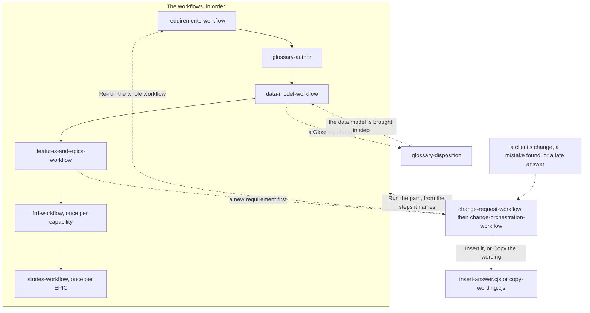

# Specifier

> **What this is:** How to use this kit. It takes a client's requirement files to stories ready to build, through six workflows and the Glossary skill. You decide at every gate.
>
> **What it is not:** The rules each skill follows, or the shape of each document. The rules are in `.claude/skills/_shared/`: `conventions.md`, `simple-writing-rules.md`, `atomic-rules.md`, `decision-review-gates.md`, and `data-model-design.md` for the data model. Each document's shape is its template, in `.claude/skills/_shared/templates/`.
>
> **Who uses it:** A specifier, the BA or the PO, working in Claude Code. Most examples are from a made-up product called Expense claims. The data model's examples are from a made-up City library.

## 1. Before you start

- **Open Claude Code in this folder,** the one that holds `.claude/` and `tools/`. The skills load from `.claude/skills/`, and every project is written to `Output/{project}/` inside it.
- **Node.js** runs the programs in `tools/`. The tests pass on Node.js 25.
- **Set up a project** with its name, which also starts the names of its main documents:

```bash
node tools/scaffold-project.cjs --project expense-claims
```

- **Put the client's requirement files** in `Output/expense-claims/sources/`, as you received them.

## 2. The workflows, in order

Five workflows run in order, with the Glossary skill, `glossary-author`, between the first two. Two more, `change-request-workflow` and `change-orchestration-workflow`, run whenever a change arrives. Part 3 shows how they connect, step by step, with a picture.

| Workflow | What it does | One run covers | Ends with |
|---|---|---|---|
| `requirements-workflow` | • lists your sources<br>• writes the Discovery brief<br>• writes the BRD<br>• writes the PRD: one requirement per row, in simple words, with the client's words next to each | the whole product | an accepted PRD |
| `glossary-author` | a skill, not a workflow: builds the Glossary from the BRD and the PRD, with two gates:<br>• Gate 1, for the words<br>• Gate 2, for their definitions | the whole product | the Glossary's seven pages |
| `data-model-workflow` | • lists the things the product keeps information about, from the Glossary<br>• writes one data model file for each family of the Glossary<br>• in each file, says what people do with each thing, the rules for each field, and how each thing moves<br>• sends every Glossary change the data model needs to `glossary-disposition` together, in one run<br>• brings the data model in step with the Glossary | the whole product | • every data model file accepted<br>• every Glossary change sent to the Glossary, and each one the Glossary settled brought into the data model |
| `features-and-epics-workflow` | • writes the Feature catalog, and gives every action and move of the data model to a feature<br>• groups the features into EPICs<br>• writes the EPIC register<br>• builds the EPIC sequencing and mapping | the whole product | the EPIC register, with its sequencing and mapping |
| `frd-workflow` | • names the next capability<br>• writes its FRD: the rules the system must always obey, with the data model's rules for its things | one capability | one accepted FRD |
| `stories-workflow` | • names the next EPIC<br>• writes its EPIC brief, when the grouping asks for one<br>• splits it into stories<br>• grooms them<br>• writes their acceptance criteria | one EPIC | that EPIC's stories marked ready |
| `change-request-workflow` | takes one or several requests to your one yes:<br>• what type of change each one is<br>• what it touches, the data model included<br>• how big it is, as a hint for priority<br>• what changes in each thing it touches, and the updates to make | one change | your yes at "Make these updates?" |
| `change-orchestration-workflow` | starts by itself after your yes:<br>• enters each update at the step its type of change names<br>• runs the workflows above from that step, with no "accept?"<br>• closes the change, and shows one summary | one change | the change closed |

Each workflow runs one piece, then stops. Run it again for the next piece. Nothing runs everything at once, except `change-orchestration-workflow`, which makes every update of a change you said yes to.

## 3. How it all connects

Each step reads the documents before it, writes its own, and stops at its gate. Below are three views: a table of every step, a table of the ways back, and a picture.

### Every step, in order

A program has no gate. "By ID" means the step only looks up what it needs in that document.

| Step | Who does it | Reads | Writes | Check program | Gate |
|---|---|---|---|---|---|
| `requirements-workflow`, step 1 | `discovery-author`. `list-sources.cjs` runs first. | your requirement files, in `sources/` | • Discovery brief<br>• Question log | `check-discovery-brief.cjs` | Accept the Discovery brief? |
| `requirements-workflow`, step 2 | `brd-author` | • Discovery brief<br>• the requirement files it marks Used | • BRD<br>• Question log | `check-brd.cjs` | Accept the BRD? |
| `requirements-workflow`, step 3 | `prd-author` | • BRD<br>• Discovery brief<br>• the requirement files it marks Used | • PRD: one requirement per row, each with its kind<br>• Question log | `check-prd.cjs` | Accept the PRD? |
| the Glossary, on its own | `glossary-author` | • BRD<br>• PRD | • the Glossary's seven pages<br>• its gate log<br>• Question log | • `check-simple-writing.cjs`, before each gate<br>• `check-glossary-sources.cjs`, before each gate: the evidence cites the PRD and the BRD, never your requirement files<br>• the method's character sweep and link check | • Gate 1: are the words settled?<br>• Gate 2: are the definitions settled? |
| `data-model-workflow`, step 1 | `things-author` | • Glossary<br>• BRD<br>• PRD | • the things file<br>• the data model's decisions file | `check-data-model.cjs` | Gate 1: the product-wide decisions, then Accept the things? |
| `data-model-workflow`, step 2 | `data-model-author`, once for each family | • the things file<br>• the decisions file<br>• Glossary<br>• BRD<br>• PRD | • one data model file, such as `lending.md`<br>• the decisions file | `check-data-model.cjs --family` | Gate 2: the file's decisions, then Accept the {family name} data model? |
| `data-model-workflow`, step 3 | `glossary-disposition`, once, with every Glossary change as one batch, once every data model file is accepted | • the Glossary changes in the decisions file, from every family<br>• Glossary | • Glossary<br>• its gate log<br>• a ripple list of the documents that use each term<br>• the new words, through `glossary-author`, in one run | after its gate: the method's character sweep and link check, and `check-simple-writing.cjs` | How should the Glossary settle each change? One at a time:<br>• change the Glossary<br>• add new words, through `glossary-author` and its gates<br>• I don't know yet |
| `data-model-workflow`, step 4 | `things-author`, then `data-model-author`, each in a change | the changed Glossary | the things file and the data model files, for the changed words only | `check-data-model.cjs` | their own gates, for what changed |
| `features-and-epics-workflow`, step 1 | `feature-author` | • PRD<br>• data model files<br>• Glossary and BRD, by ID | • Feature catalog. Its section 5 gives every action and move of the data model to a feature.<br>• Question log | `check-features.cjs` | Accept the Feature catalog? Each "?" row is settled first. |
| `features-and-epics-workflow`, step 2 | `epic-grouping-author` | Feature catalog | • EPIC grouping<br>• Question log | `check-epic-grouping.cjs` | Pick a grouping, settle its clashes, confirm the EPIC brief list |
| `features-and-epics-workflow`, step 3 | `epic-author`, register mode | EPIC grouping | EPIC register | `check-register.cjs` | none: a pass of the check is the acceptance |
| `features-and-epics-workflow`, step 4 | `build-sequencing-mapping.cjs`, a program | • EPIC register<br>• EPIC grouping | • EPIC sequencing<br>• EPIC mapping | none | none |
| `frd-workflow`, step 1 | `route-next-capability.cjs`, a program | • EPIC register<br>• Feature catalog | the next capability to write | none | none |
| `frd-workflow`, step 2 | `frd-author` | • Feature catalog<br>• PRD, Glossary and data model files, by ID | • FRD: its rules, and its Data, copied word for word from the data model. The one exception is a cell that a decision at its gate changed. That cell says the new answer, with its note. Its two coverage tables show a rule for each "Done when" piece and each data model answer.<br>• Question log | `check-frd.cjs` | Accept the FRD? Its Must answer questions come first. |
| `stories-workflow`, steps 1 and 2 | `route-next-epic.cjs`, then `route-brief-list.cjs`, both programs | • EPIC register<br>• EPIC grouping<br>• every Story list | the next EPIC, and whether it gets an EPIC brief | none | none |
| `stories-workflow`, step 3 | `epic-author`, brief mode, only for an EPIC that gets a brief | • EPIC register<br>• BRD, PRD and Feature catalog, by ID | • EPIC brief<br>• Question log | `check-epic-brief.cjs` | Accept the EPIC brief? |
| `stories-workflow`, step 4 | `story-drafter` | • EPIC register<br>• FRDs | • Story list<br>• Question log | `check-stories.cjs` | Approve the split? |
| `stories-workflow`, step 5 | `story-groomer` | • Story list<br>• the Stories<br>• FRDs, by ID | • the Stories, groomed<br>• Question log | `check-stories.cjs` | Accept the grooming? |
| `stories-workflow`, step 6 | `ac-author` | • the Stories<br>• FRDs, by ID | • the Stories' acceptance criteria, and their ready marks<br>• Question log | • `check-stories.cjs`<br>• `coverage-check.cjs` | Accept the criteria? This marks the stories ready. |
| `change-request-workflow`, step 1 | the workflow, then `compare-versions.cjs`, `glossary-check` and `glossary-disposition`, each only when it is needed | your requests, and the files you bring | • the Change impact report, sections 1 to 4<br>• Check findings, for a document from outside | `glossary-disposition`'s checks, after its gate | How should each mismatched word be settled? Only for a word that doesn't match. |
| `change-request-workflow`, step 2 | `change-request-disposition`, then `adversarial-check` | • the report<br>• the Glossary and the FRDs | • the type of change, sections 5 and 7 to 10<br>• the challenge, section 11<br>• Question log | none | none |
| `change-request-workflow`, step 3 | `change-impact-author`, then `find-linked.cjs` and `size-rules.cjs` | every document the change lands on, the data model included | where it lands, what's linked, and how big, sections 6, 12 and 14 | none | none |
| `change-request-workflow`, step 4 | `feature-impact`, once for each linked item | the report, and that item | what changes in each, section 13 | none | none |
| `change-request-workflow`, step 5 | the workflow, with `recommend.cjs` | the report | the updates to make, section 15, and your decision, section 16 | `check-change-report.cjs` | Make these updates? |
| `change-orchestration-workflow` | the workflows the updates name, from the steps they name, then `close-change.cjs` and `change-summary.cjs` | the change's to-do list | a new version of each document the change names | each skill's own check | none: your yes covered it |

Three things happen inside the steps:
- **The questions.** Each skill that writes the Question log runs probing-questions-author, then `grade-questions.cjs`, before its check. Each gap becomes a question, asked at the gate. things-author and data-model-author don't. Their decisions stay in the data model's decisions file, never in the Question log.
- **The check.** Each document's check program checks simple writing. A file with no check program gets the quick check, `tools/check-simple-writing.cjs`. Two more checks run where they fit:
  - one requirement per row: the check lists each row that may hold two, for you to look at. It runs where requirements, rules or stories are written.
  - the agreed Glossary words: once the project has a Glossary, the check finds any word it retired. It runs on the PRD, the data model, the features, the EPIC grouping and briefs, the FRDs and the stories.
- **The acceptance.** Every "yes" at a gate runs `tools/accept.cjs`.

### The ways back

Most steps only go forward. When a step finds something that an earlier document must settle, it goes back one of these ways. A later gate never sends an answer back. The latest document wins, as the FRD's row shows. The examples are from a City library.

| What is found | Where | Where it goes |
|---|---|---|
| A rule the sources leave open, such as how long a book's title can be | the data model | a data model decision, DM-1 onward, asked at the data model's gate. It stays in the decisions file, never in the Question log. |
| A word the Glossary doesn't settle, such as a Shelf status that belongs to no thing | the data model | a Glossary change, GC-1 onward. Once every data model file is accepted, step 3 of `data-model-workflow` sends them all together. `glossary-disposition` settles them as one batch, in one run. Step 4 then brings the data model in step. Each change is marked as it goes:<br>• "To raise"<br>• then "Raised"<br>• then "Settled in the Glossary on {date}", or "Left open on {date}" for "I don't know yet"<br>• then "Brought into the data model on {date}" |
| Two requirements that disagree, such as 3 loans at a time and 5 | the data model | a data model decision, DM-1 onward. Its options are the answers the requirements give, and you pick one at the data model's gate. The requirements stay as they are. |
| An action or a move that no feature names | the Feature catalog, section 5 | a "?" row, settled at the catalog's gate. You give it to a feature, or pick "a new requirement first". Then the row reads "waits on change" and the change's number. |
| A decision that changes a data model answer, such as a longer limit for a book's title | an FRD's gate | nowhere: the FRD moves forward. It says the new answer, with the note *Updated from the data model on the basis of Decision n: …*. The data model file stays as it is. The latest document wins, so the stories copy the FRD. |
| A mistake in a document you've already accepted | any step | a change, through `change-request-workflow` |
| An answer to an open question, after the documents that use it exist | the Question log | a change. `insert-answer.cjs` can write a small answer wherever the documents name the question, the data model files included. A small answer has Low impact, or confirms the answer in use. |
| A change | `change-request-workflow`, then `change-orchestration-workflow` | the documents its recommendation names, from the steps it names, the data model included. A change that reaches more than half of the business requirements also offers a re-run from `requirements-workflow`, step 1. A re-run starts the project again from nothing. |
| A loop in the EPICs' dependencies | `features-and-epics-workflow`, step 4 | back to step 2, where the grouping's dependencies are settled |

### The picture

Solid arrows show the order of the workflows. Dotted arrows show the ways back.



## 4. How to run a workflow

Ask Claude for it by name, with your project, or type its name after a slash:
- "run requirements-workflow for expense-claims"
- "write the next FRD for expense-claims"
- `/stories-workflow expense-claims`

A workflow calls its skills in order, and each skill stops at its gate for your decision. You answer at the gate. Nothing is accepted without you.

## 5. How to run a skill on its own

Every skill also runs without its workflow. Give it the project, and the piece when it works on one. It finds the documents it needs, or tells you which one is missing.

| Skill | What it writes | You give | For example |
|---|---|---|---|
| `probing-questions-author` | the questions a draft raises, rated, in the Question log | the project and the document | "raise the questions for the expense-claims BRD" |
| `discovery-author` | the Discovery brief: what the sources say, where they clash, and what they leave out | the project | "start discovery for expense-claims" |
| `brd-author` | the BRD: the business case and the business requirements | the project | "write the BRD for expense-claims" |
| `prd-author` | the PRD: one requirement per row, in simple words, each with its kind, the client's words and its source. A word that can't be checked becomes a question. | the project | "write the PRD for expense-claims" |
| `glossary-author` | the Glossary, with its two gates. In its mode "add words from a request", only the new words `glossary-disposition` sends it, all in one run. | the project, and for a request, each new word with its evidence | "build the glossary for expense-claims" |
| `glossary-check` | where a document drifts from the Glossary | the project and the document | "does this story use the agreed terms?" |
| `glossary-disposition` | a changed Glossary word: each drifted word settled. Or every Glossary change the data model raised, settled as one batch, in one run. | the project and the findings, or the word to change, or the data model's batch | "rename claim to expense claim" |
| `things-author` | the things file: every thing the product keeps information about, by its Glossary family, and the decisions every family shares | the project | "find the things for city-library" |
| `data-model-author` | one family's data model file, and its decisions | the project and the family | "write lending.md for city-library" |
| `feature-author` | the Feature catalog, with the feature for every action and move of the data model | the project | "define the features for expense-claims" |
| `epic-grouping-author` | the EPIC grouping: options, the pick, and its clashes | the project | "group the expense-claims features into EPICs" |
| `epic-author` | the EPIC register, or one EPIC's brief | the project, and the EPIC for a brief | "write the EPIC brief for EPIC-002" |
| `frd-author` | one capability's FRD, with the data model's rules for its things | the project and the capability | "write the FRD for Claim approval" |
| `story-drafter` | one EPIC's Story list | the project and the EPIC | "split EPIC-002 into stories" |
| `story-groomer` | the grooming of one EPIC's stories | the project and the EPIC | "groom EPIC-002's stories" |
| `ac-author` | the acceptance criteria of one EPIC's stories | the project and the EPIC | "write the acceptance criteria for EPIC-002" |
| `change-impact-author` | the analysis of one change, and your decision on it | the project and the change | "analyse change 001 for expense-claims" |
| `adversarial-check` | a hostile second reading of a change's analysis | the project and the change | "challenge change 001 for expense-claims" |
| `feature-impact` | whether one item, or one data model row, is hit by a change, and what to do | the change and the item | "does change 001 hit F-05.1?" |

## 6. At each gate

Every gate works the same way, as `.claude/skills/_shared/decision-review-gates.md` sets out:
- It opens with what the check found, and how many questions are open.
- Each open question comes one at a time: why it is asked, an example, what it changes, the real choices, "I don't know yet", and the one recommended.
- Then the gate's own question, such as "Accept the FRD?".

At the data model's two gates, its decisions come first, as multiple choice. The Feature catalog's gate settles each "?" row of its section 5 before you can accept it.

When you accept, `tools/accept.cjs` runs. It saves a numbered copy of the document in the Version log. It saves a copy of the Question log too. For the data model, it saves the decisions file too. Then it rebuilds the Traceability map, and brings every open change's progress up to date.

An FRD or an EPIC can be parked after your third "no". Then you can work on something else while it waits.

## 7. What's next: status.cjs

Ask "what's next for expense-claims", or run:

```bash
node tools/status.cjs --project expense-claims
```

It prints one line for each document, workflow by workflow. Then it lists the open changes, and every Must answer question still open. Then it lists every data model decision and Glossary change still open, such as one answered "I don't know yet". The next run of `data-model-workflow` asks each of those again first. It ends with what to run next. Under that line, it names the skill that asks each one again. They hold up no other step. It also lists each accepted FRD that waits on a data model answer now settled. frd-author brings that answer forward. An example:

> requirements-workflow
> - 1. Discovery brief: accepted on 2026-10-14, version 1
> - 2. BRD: accepted on 2026-10-15, version 2
> - 3. PRD: drafted
>
> Must answer, still open
> - question 4: Which currencies can a claim be made in? Answer by: before the FRD for making a claim is accepted.
>
> Next: requirements-workflow, step 3: prd-author writes the PRD

A piece that waits on an open Must answer question goes to the back of the queue. So does a parked piece. So "Next" names what you can finish first.

## 8. Where documents land

Everything for a project is in `Output/{project}/`. The full map, with every file and the step that writes it, is `.claude/skills/_shared/project-folders.md`. The main ones, for `expense-claims`:

| Document | Where |
|---|---|
| your requirement files | `sources/` |
| Discovery brief | `expense-claims-discovery-brief.md` |
| BRD | `expense-claims-brd.md` |
| PRD | `expense-claims-prd.md` |
| Question log | `expense-claims-question-log.md` |
| Glossary | `glossary/`, with its gate log in `glossary/deep-dives/` |
| the data model | `glossary/data-models/`:<br>• the things file, `expense-claims-glossary-things.md`<br>• one data model file per family, such as `claims.md`<br>• the data model's decisions, `expense-claims-data-model-decisions.md` |
| Feature catalog | `frd/feature-catalog.md` |
| FRDs | `frd/`, one per capability, such as `frd/frd-claim-approval.md` |
| EPIC grouping, register, sequencing and mapping | `epics/`: `grouping.md`, `register.md`, `sequencing.md` and `mapping.md` |
| an EPIC's own documents | its folder, such as `epics/EPIC-002-claim-approval/`:<br>• its EPIC brief<br>• its Story list<br>• its Stories |
| design files you bring | `design/` |
| a change's documents | its folder, such as `changes/001-finance-limit/`:<br>• its Change impact report<br>• the check findings on documents from outside, if any<br>• its progress |
| every accepted version | `version-log/` |
| Traceability map | `traceability-map.json` |

## 9. Raising a change

Raise a change whenever:
- the client changes a requirement
- you find a mistake in an accepted document
- an answer to an open question arrives after the documents that use it exist

One step leads to a change too. At the Feature catalog's gate, you may pick "a new requirement first" for an action or a move.

Two things never raise a change. The data model never comments on the requirements: two requirements that disagree become a data model decision. And a decision at an FRD's gate that changes a data model answer stays in the FRD, with its note.

Call `change-request-workflow` in your own words, with any files that came with it. Several requests can go together:
- "change request for expense-claims: the finance limit goes up from 500 to 1,000"
- "new request for expense-claims: a claimant can attach a photo of a receipt"
- for a late answer: "change request for expense-claims: question 7 is answered: 10 working days, and 1 claim in 20 sent back"

It writes a Change impact report in `changes/{number}-{short name}/`. It says what type of change each request is, what it touches, the data model included, how big it is, and what changes in each thing. Then it asks you once, "Make these updates?". It gives you the choices that fit the change:
- **Run the path:** `change-orchestration-workflow` makes every update, in order, from the step each one enters at. It asks no "accept?" again. It stops only for a question only you can answer, or for something the change didn't list.
- **Insert it:** for a late answer, a program writes it wherever the documents name its question, and nothing is re-run
- **Copy the wording:** for a reworded requirement, a program copies the new wording to every place that quotes it
- **Re-run the whole workflow:** offered when the change reaches most of the business requirements. It starts the project again from nothing, from `requirements-workflow`, step 1. It happens only when you ask for it in words, such as "start the project again from nothing", and say yes to what will move. Every file and folder in `Output/{project}/` except `sources/` moves to `_archive/Output-{date}/{project}/`, at the top of the kit. No program does this move yet: the workflow does it by hand. Then every step runs fresh.
- **Close it:** when the documents already say it
- **Correct the analysis:** when something in the report is wrong

The size is a hint for priority. It pauses nothing. The change closes by itself when the last document it named is saved, and `change-summary.cjs` shows what changed. There is no undo: a reversal is a new change request. Until then, `status.cjs` lists it under "Open changes".

## 10. What's in this folder

- `.claude/skills/`: one folder per skill and workflow
- `.claude/skills/_shared/`: what every skill shares
  - `conventions.md`: the rules every document follows
  - `simple-writing-rules.md`: how every document and gate message is written in simple words, with the word lists the check reads
  - `atomic-rules.md`: one requirement per row, wherever requirements, rules, stories or tests are written
  - `quality-characteristics.md`: the ten tests, Q1 to Q10, that each requirement, feature, story and acceptance criterion must pass
  - `decision-review-gates.md`: how every gate is held
  - `project-folders.md`: where every file goes
  - `data-model-design.md`: how the data model is written from the Glossary, the BRD and the PRD
  - `templates/`: one template per document
  - `examples/`: a worked example of the first documents, for Expense claims
  - `glossary/`: the Glossary's method
- `tools/`: the programs the skills run, which you can also run yourself
  - `lib/`: the code the programs share
  - `tests/`: the programs' tests. Run each file with Node.js, such as `node tools/tests/requirements.test.cjs`.
- `fixtures/`: the test data the tests run on
- `Output/`: your projects, one folder each
