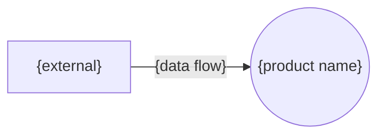
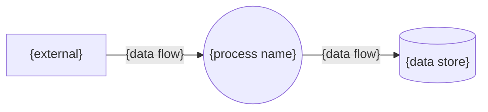

# Data flows — {product name}

> **What this is:** Where the product's data comes from, which processes transform it, where it is kept, and who or what receives it: the context diagram, and a level 1 diagram when the product has more than one process.
>
> **What it is not:** The order of the product's stages, which is the Glossary's flow, or what each exchange with the outside involves, which is the interfaces'.
>
> **Written by:** data-flow-author, from `templates/data-flows.md`. Checked by check-data-information.cjs before its gate.

> **Lineage**
> - **Previous step:** {previous step}
> - **Primary source:** [data-model.md](data-model.md)
> - **Supporting sources:**
>   - [glossary/](../glossary/)
>   - [data-dictionary.md](data-dictionary.md)
>   - [{product}-prd.md](../{product}-prd.md)
> - **Next step:** each external's interface is analysed, by interface-author -> [interfaces.md](interfaces.md)

Status: drafted

## Externals

*Every person, organization or system outside the product that sends it data or receives data from it, in the Glossary's words where it has one. Each has at least one data flow.*

| External | Kind |
|---|---|
| {external} | {kind} |

## Processes

*Every activity that turns data in into data out, named with a verb and a noun. Each has at least one data flow in and one out.*

| Process | Name | Glossary step |
|---|---|---|
| {process ID} | {process name} | {glossary step} |

## Data stores

*Where data is kept for later, one for each entity whose data the processes keep. Each has at least one data flow.*

| Data store | Entity |
|---|---|
| {data store} | {entity} |

## Data flows

*Every movement of data, named with a noun, from an external, process or store to another, one of them a process. "Data" names the entities or attributes that move, by ID.*

| Data flow | Moves | Data |
|---|---|---|
| {data flow} | {from} → {to} | {data} |

## Context diagram

*The product as one process, with every external and the data flows between them, drawn from the tables above.*

## Level 1 diagram

*The processes, data stores and externals, and every data flow between them, drawn from the tables above. "Does not apply:" and why, when the product has only one process.*

## Decision record

*Every decision made at the data flows' gate, in the order made, in the shape of `templates/parts/decision-record.md`.*

None yet.

## Check record

*The record of the last check, pasted exactly as check-data-information.cjs printed it.*

None yet.

## Placeholders

*What to write for each label in this template, with an example from the made-up Expense claims product. This section is never copied into the document.*

| Label | What to write | Example |
|---|---|---|
| {product name} | the project's name | Expense claims |
| {product} | the project's name, as its folder has it | expense-claims |
| {previous step} | the document before it that was written: State models, or Data Dictionary when state-model-workflow did not run | State models |
| {external} | a person, organization or system outside the product | Employee |
| {kind} | Person, Organization or System | Person |
| {process ID} | P and a number, from 1 | P1 |
| {process name} | a verb and a noun | Send a claim |
| {glossary step} | the Glossary step it comes from, or - | Submission |
| {data store} | the store's name: the entity's name, in the plural | Claims |
| {entity} | the entity whose data is kept there | Claim |
| {data flow} | a noun naming the data that moves | Claim details |
| {from} and {to} | an external, process ID or data store | Employee → P1 |
| {data} | the entities or attribute IDs that move, one per line | • Claim.amount • Expense line |
