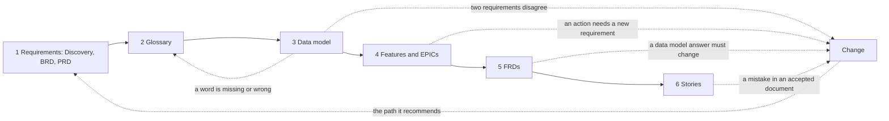

# Stitching the data model into the kit: the plan

Status: Every decision in part 6 was settled on 2026-11-02. The build started on 2026-11-02, from commit 816c7ee. Steps 1 to 13 of part 7 are built, and not committed. All 528 tests pass. Part 9 lists what you decided during the build.

Next step: the fresh trial in part 8. Part 10 lists what is left for later.

> **What this is:** The plan to join the data model to every workflow of the kit. It covers both directions. Going forward, the data model sits between the Glossary and the features. Going back, a gap found in the data model can go back to the Glossary or the PRD. And a change that comes in later can reach the data model. It also puts the writing rules into every step: simple English, one requirement per row, and the agreed Glossary words (part 7.1).
>
> **What it is not:** The file-by-file forward edits. Those are in `data-model-kit-plan.md`, part 3, and they stay as they are. This plan names the edits that file doesn't have, and the order to build everything in.

*The examples are for a made-up City library: members borrow books, and each borrowing is a Loan.*

---

## 1. The whole flow, after stitching

| # | Workflow | What it does | Starts when | Ends with |
|---|---|---|---|---|
| 1 | `requirements-workflow` | Discovery brief, BRD, PRD | the requirement files are in `sources/` | an accepted PRD |
| 2 | `glossary-author` | one agreed word for each meaning | the PRD is accepted | the Glossary written |
| 3 | **`data-model-workflow`** (new) | the things, then one data model file per Glossary family, then the Glossary changes it found | the Glossary is written | every data model file accepted, and in step with the Glossary |
| 4 | `features-and-epics-workflow` | features, EPICs, build order | every data model file is accepted | the EPIC register |
| 5 | `frd-workflow` | one FRD per capability | the EPIC register is written | every FRD accepted |
| 6 | `stories-workflow` | stories and tests, one EPIC at a time | the FRDs of that EPIC's features are accepted | every EPIC ready |
| – | `requirement-update-workflow` | one change, at any time | a change arrives, or a step finds a mistake in an accepted document | your decision on what to run |

The solid arrows are the normal order. The dotted arrows are the ways back. Every way back to an accepted document goes through a change. The kit never edits an accepted document outside a change (`conventions.md`, part 17). The only exception is a Glossary change found by the data model. That goes straight to `glossary-disposition`, as you decided on 2026-10-30, because it changes words, not requirements.

---

## 2. What the data model can find, and where each one goes

This table is the heart of the plan. When a data model step meets a gap, it asks one question: **what kind of gap is this?** The answer decides where the gap goes. A gap never goes to two places.

| # | What the data model finds | Example | Where it goes | Goes back to the PRD? |
|---|---|---|---|---|
| 1 | A rule the sources leave open: a limit, whether two can share a value, whether it can change, what it starts as | The PRD says a book has a title, but gives no length | A data model decision, asked at gate 2 | No |
| 2 | Who does an action, when the Glossary has the role but the sources don't say | No requirement says who can remove a member | A data model decision, asked at gate 2 | No |
| 3 | The Glossary is silent about a term, or says two different things | The Glossary has no values for Loan state | A Glossary change, raised through `glossary-disposition` once every data model file is accepted | No |
| 4 | Two requirements say different things, or the BRD and the PRD disagree | One requirement says 3 loans per member. Another says 5. | **Decision 1** | Yes, if you choose A |
| 5 | The PRD left a question open, and the data model needs its answer | Question 7, "How long is a loan?", is still open | **Decision 2** | Only when the answer arrives late |
| 6 | Something no requirement says, small enough to be a rule | Members can edit their phone number | A data model decision. The FRD proves it later. | No |
| 7 | Something no requirement says, big enough to be a feature of its own | Members can reserve a book that is on loan | A new requirement, through a change. `feature-author` finds this when it gives every action to a feature (`data-model-kit-plan.md`, 3.2). | Yes |

**Two rules that hold for every row:**
- **A data model decision is only ever about a rule.** If its answer would add a word, a state or a value the Glossary doesn't have, it becomes a Glossary change instead (row 3).
- **The data model's decisions stay with the specifier.** Rows 1, 2 and 6 are your answers, not the client's. The client sees them only as FRD rules (Decision 3).

---

## 3. Going back from later steps to the data model

Once a data model file is accepted, it is changed only through a change, like any other accepted document.

| Step | What it finds | What happens |
|---|---|---|
| `feature-author` | an action or a move that no feature names | the four answers in `data-model-kit-plan.md`, 3.2. One of them is "a new requirement first, through `requirement-update-workflow`". |
| `frd-author` | a decision at its gate that would change a data model answer, such as a longer title | It pauses. You raise it as a change: "a mistake found in an accepted document". The change's path runs `data-model-author` for that thing, then the FRD goes on. The FRD never differs from the data model. |
| `story-groomer`, `ac-author` | the same | the same |
| `glossary-disposition`, later in a change | a renamed word that the data model files use | Its ripple list names the data model files. The change's path runs `data-model-author` for the things that use the word. |

`data-model-kit-plan.md`, 3.3, item 7 says the FRD raises such a decision "through `data-model-author`". This plan sharpens that: the FRD raises it **as a change**, and the change's path runs `data-model-author`.

**Nothing to fix for the BRD and the PRD when a Glossary word changes.** They are written before the Glossary, in the client's words. The Glossary's section decisions files and its "Terms replaced or retired over time" tables connect the client's words to the agreed ones. So a renamed word doesn't make the PRD wrong.

---

## 4. A change that arrives later must reach the data model

Today `requirement-update-workflow` knows the PRD, the Feature catalog, the EPICs, the FRDs and the stories. It doesn't know the data model. Without these edits, a change to "a member can borrow 5 books" would reach the FRD but miss the data model. Then the two would differ.

**How a change finds the data model, with no citations.** The data model files cite no source, by design. So no link leads from a requirement to a data model row. A change finds them through the Glossary instead. change-impact-author already restates every change in the Glossary's words. Each Glossary word for a thing leads to one data model file, through the things file. From the data model, the FRD rules that name it as their source (`data model — Loan, Extend`) lead on to the stories and the tests.

| File | The edit |
|---|---|
| `change-impact-author/SKILL.md` | Step 1, item 4, "Place it": for each ask, also name each thing the ask touches, and its action, field or move, from the things file |
| `_shared/templates/change-impact-report.md` | Section 6 gets a "Data model" column, with its placeholder |
| `tools/check-change-report.cjs` | reads the new column, and checks every thing it names is in the things file |
| `tools/traceability-map.cjs` | a reader for the things file and the data model files, and a new link from an FRD rule to the data model row it names |
| `tools/find-linked.cjs` | starts from the data model rows in section 6 too, and follows them to the FRD rules that name them |
| `feature-impact/SKILL.md` | can judge a data model row: No change, or Update with the exact edits |
| `tools/recommend.cjs` | two new steps, `things-author` and `data-model-author`, in `data-model-workflow`. They sit after `glossary-author` and before `feature-author` on the Net new and Extend paths, and before `frd-author` on the Update path. A step with nothing to do is left out, as today. |
| `tools/accept.cjs`, `tools/version-log.cjs`, `tools/lib/run-paths.cjs` | document names for the things file, each data model file and the data model's decision register, so each acceptance saves a version. A change needs those versions to see what changed. |
| `tools/size-rules.cjs`, `tools/status.cjs` | a data model file being drafted counts as work in progress. Like the Feature catalog, it is never parked, because the change's path writes it again. |
| `tools/track-change.cjs` | one progress row for each data model file a change sends work to |
| `tools/insert-answer.cjs` | looks in the data model files too, when a late answer arrives (Decision 2) |

---

## 5. Starting again, and picking up where you stopped

Today both data model skills stop when their file already exists, except in a change. `glossary-author` already knows three modes. The data model skills get the same three:

| Mode | How the skill knows | What it does |
|---|---|---|
| New build | no things file | runs from step 1 |
| Picking up | a things file, and some families with no accepted file | goes on with the next family with no accepted file |
| Re-run of the whole workflow | every file exists, and you started again from `requirements-workflow`, step 1 | asks again every data model decision answered before, keeping its number, with the earlier answer recommended and dated, as `conventions.md`, part 15 says for questions. Removed on 2026-11-03: a run from step 1 now starts the project again from nothing, so the data model starts as a new build. |

In a change, the skills change only what the change names. They already do this.

---

## 6. Decisions to settle first

Seven questions, all settled on 2026-11-02. The first answer under each one was the recommended answer.

### Decision 1: Two requirements disagree. What do we do?

**Settled on 2026-11-02: A, fix the PRD first, through a change.**

*For example:* one requirement says a member can borrow 3 books. Another says 5.

- **A. Fix the PRD first, through a change.** The data model waits on that one thing. *Why:* the PRD stays correct.
- B. The data model picks one. The PRD still says both.
- C. Ask the client. Use our best answer until they reply.

### Decision 2: The PRD has an open question that the data model needs. What do we do?

**Settled on 2026-11-02: A, use our best answer for now, marked as not yet confirmed.**

*For example:* "How long is a loan?" has no answer yet.

- **A. Use our best answer for now, and mark it as not yet confirmed.** *Why:* every other step already does this.
- B. Copy the question into the data model's own list of decisions.
- C. Leave a "?" in the data model, and don't use the question.

### Decision 3: Does the client see the decisions we make in the data model?

**Settled on 2026-11-02: B, no. The decisions stay with the specifier. The client sees them only as FRD rules.**

*For example:* we decide a book title can be up to 200 characters.

- **A. Yes. They go on the list we send the client.** *Why:* the client didn't say it, so the client should confirm it.
- B. No. The client sees them only later, as FRD rules.

### Decision 4: Build first, or try first?

**Settled on 2026-11-02: A, build it into the kit first. The commit and the trial come later.**

- **A. Build it into the kit, then try it on a fresh project.** *Why:* only the real kit can test the ways back.
- B. Try it by hand first, then build it into the kit.

### Decision 5: Rename the data model's decision file?

*Why we ask:* the Glossary folder has two files with the same kind of name, "decision register".

**Settled on 2026-11-02: A, rename it to `{product}-data-model-decisions.md` in the move.**

- **A. Yes, to `{product}-data-model-decisions.md`, when the files move into the kit.**
- B. No. Keep `{product}-glossary-decision-register.md`.

### Decision 6: Where do the "one requirement per row" rules live?

*Why we ask:* today only prd-author has them. Every other skill has only Q1's one-line test.

**Settled on 2026-11-02: A, their own file.**

- **A. Their own file, `_shared/atomic-rules.md`, next to `simple-writing-rules.md`. Q1 points to it, and every skill that writes requirements, rules, stories or tests points to it.**
- B. Inside Q1, in `quality-characteristics.md`.

### Decision 7: Which step brings the PRD's simple words in line with the Glossary?

*Why we ask:* `conventions.md` says the PRD's simple words are brought in line once the Glossary agrees its words, before the Feature catalog. No step does it today.

**Settled on 2026-11-02: C, leave the PRD alone.** First answered A, then changed the same day. *Why:* the Glossary is built from the PRD, and the Glossary takes its own decisions. Going back to change the PRD would start a loop: a changed PRD would call for the Glossary again. The flow only goes forward. Part 3's "Nothing to fix for the BRD and the PRD" stands. `conventions.md`'s line "the PRD's simple words are brought in line once the Glossary has agreed its words" is removed in the build. The PRD uses the agreed words only when the Glossary already exists, in a re-run or a change.

- A. The first step of `data-model-workflow`: prd-author swaps only the retired words in "In simple words", leaves "The client's words" as they are, and holds its own gate. The data model then reads the agreed words.
- B. The last step of glossary-author, after its Gate 2.
- C. Leave the PRD alone. The Glossary's "replaced" tables link the old words to the agreed ones.

---

## 7. The build, one activity per step

**Before the build starts:** everything is committed, and you have copied over the skills. Then one session builds. No other session edits the kit at the same time.

Each step ends with your review. "Kit plan" means `data-model-kit-plan.md`.

| # | Step | Needs first | Where it is written |
|---|---|---|---|
| 1 | Make the kit's tests pass on this PC. About 40 fail today, the same ones that failed at the last commit. The likely cause is Windows line endings: `core.autocrlf` is on, and there is no `.gitattributes`. | – | – |
| 2 | Move the drafts into the kit. The design goes to `_shared/data-model-design.md`, the three templates to `_shared/templates/`, and the three skills to `.claude/skills/`. The decisions file becomes `{product}-data-model-decisions.md`. `_data_model/` keeps only the working notes. | 1 | kit plan 3.4, decision 5 |
| 3 | Put the data model in the order of the workflows. glossary-author hands over to `data-model-workflow`. `features-and-epics-workflow` and feature-author start once the data model is accepted. The project folders, the setup program, the README and `status.cjs` know the data model. `conventions.md` loses its line that brings the PRD in line with the Glossary. | 2 | kit plan 3.1, decision 7 |
| 4 | Give every action and move to a feature: feature-author's new step, the catalog's section 5, `check-features.cjs`, and a shared reader, `tools/lib/data-model.cjs` | 3 | kit plan 3.2 |
| 5 | Make the FRD read the data model: frd-author, its conventions, the FRD template, `check-frd.cjs` and `check-document.cjs` | 4 | kit plan 3.3, with this plan's part 3 |
| 6 | Teach the data model skills where each gap goes | 2 | this plan, part 2, and decisions 1 to 3 |
| 7 | The three modes: new build, picking up, re-run | 6 | this plan, part 5 |
| 8 | Simple English in every skill, every time, with the quick check after every file a skill writes | 2 | this plan, part 7.1 |
| 9 | One requirement per row: the rules file, its shared check, and the skills and check programs that write requirements, rules, stories or tests | 2 | this plan, part 7.1, and decision 6 |
| 10 | The agreed Glossary words in every document after the Glossary | 2 | this plan, part 7.1 |
| 11 | The data model's check program, `check-data-model.cjs`: the design's 11 checks, plus the three checks of steps 8 to 10. The data model files get the kit's opening blocks, and their status comes from `accept.cjs`. | 6, 8, 9, 10 | kit plan, part 4, item 1 |
| 12 | Let a change reach the data model | 5, 11 | this plan, part 4 |
| 13 | The sample project and the tests | 2 to 12 | kit plan 3.5, plus tests for each new check and for a change that reaches the data model |
| 14 | The fresh trial | 13, and a commit | this plan, part 8 |

Steps 6 and 7 change only the data model's own files. Step 12 changes only the change programs.

### 7.1 The writing rules in every step

**Simple English: every skill, every file, every time.** You said on 2026-11-02 that it is cross-cutting: it must apply every time, then a quick check keeps us in control.
- `simple-writing-rules.md` opens with the rule: every skill follows it for every file it writes or changes, and for every gate message, every time.
- After it writes, every skill runs the quick check, `tools/check-simple-writing.cjs`, on each file it wrote or changed, and fixes what the check lists to fix. A check program that already runs the check counts. The gate shows one line, such as "Simple writing: 0 to fix, 4 to look at."
- These skills write files today with no quick check. Each one gets it:
  - adversarial-check
  - feature-impact
  - glossary-disposition
  - probing-questions-author, for the Question log
  - epic-author, for the EPIC register, through `check-register.cjs`
  - glossary-author, for its deep-dive files as well as its seven pages
  - things-author and data-model-author
- No program can check a gate message. For gate messages, the rule is an instruction only.

**One requirement per row: wherever requirements, rules, stories or tests are written.**
- A new `_shared/atomic-rules.md`, next to `simple-writing-rules.md`: what one requirement is, when to split, and when to keep together, from parts 1 and 2 of `_archive/root-notes-2026-11-02/atomic-requirements-model.md`, with a generic example. Q1 in `quality-characteristics.md` points to it, as Q7 points to `simple-writing-rules.md`.
- A new shared check in `tools/lib/`, built like `simple-writing.cjs`. It lists rows that may hold two things as "to look at", because only a person can judge them. `check-prd.cjs` moves onto it.
- The skills that point to the rules: brd-author, prd-author, feature-author, frd-author for its rules, story-drafter, story-groomer, ac-author and data-model-author.
- The check programs that run the check: `check-brd`, `check-prd`, `check-features`, `check-frd`, `check-stories` and `check-data-model`.

**The agreed Glossary words: every document after the Glossary.**
- `lib/scan-retired-words.cjs` is added to `check-frd`, `check-epic-grouping` and `check-data-model`. The PRD, Feature catalog, EPIC brief and stories checks already run it.
- On a first run, the PRD is never sent back to match the Glossary (decision 7).

---

## 8. The fresh trial

**The project.** Continuum, from its requirement files. Before the trial, today's `Output/continuum/` moves to `_archive/Output-2026-11-02/continuum/`. Then its `sources/` folder is copied back to `Output/continuum/sources/`, so the trial starts with the requirement files only. This run is also step 7 onward of `_archive/root-notes-2026-11-02/simple-writing-plan.md`, and the trial of `_archive/root-notes-2026-11-02/prd-fixes-plan.md`. So the same run tests all three plans.

**The run, in order:**

| # | What | Ends with |
|---|---|---|
| 1 | `requirements-workflow` | the PRD accepted |
| 2 | `glossary-author` | the Glossary written |
| 3 | `data-model-workflow` | every data model file accepted, and the Glossary changes settled |
| 4 | `features-and-epics-workflow` | the EPIC register |
| 5 | `frd-workflow`, for the first capability in the register | its FRD accepted |
| 6 | `stories-workflow`, for that capability's EPIC | its stories ready |
| 7 | One change through `requirement-update-workflow` that changes a data model answer | the change closed |
| 8 | Run step 5 again, fresh, from the same files, and compare the two FRDs | – |

**The trial works when:**
- every gap the data model finds goes to exactly one of the destinations in part 2
- every action and move has a feature
- every action, field and move the FRD's features own has a rule, and every rule has a test
- nothing is invented
- the change in step 7 reaches the data model file, the FRD rule and the test, and nothing it touches is missed
- the two FRDs in step 8 have the same rules, with the same sources
- every row of the PRD has a kind, and no Purpose, Scope or Way of working row needs a feature
- every Requirement row of the PRD can be checked yes or no, or names its question
- nothing in the PRD is invented: no number, step or rule that the client's words don't give

---

## 9. Decisions taken during the build, 2026-11-02

You took these while the build ran. Each one is built.

1. A change to the requirements is raised at the end of `data-model-workflow`, as its step 5.
2. A change to the requirements has an RC-n ID, such as RC-1.
3. Each change to the requirements is raised on its own, through its own run of `requirement-update-workflow`.
4. The gate rules name the data model as the one exception for "I don't know yet". Its open decisions stay in its own decisions file.
5. data-model-author has one gate. It asks the decisions first, then "Accept the {family name} data model?".
6. An open data model cell shows "? (DM-n)". The FRD copies it, and waits on that ID.
7. There is one test for "big enough to be a feature", the data model's. feature-author uses it too.
8. In the Feature catalog's section 5, a row that waits on a new requirement reads "waits on change {nnn}".
9. In the Feature catalog's section 5, a row no feature names shows "?" until the gate. "I don't know yet" uses the recommendation, marked Proposed.
10. At the Feature catalog's gate, a new requirement only opens its change. The rest of the change runs after the gate.
11. Every skill file is cleaned to 0 to fix, the approved copies included.
12. Build everything first, and test later.
13. The trial runs the PRD step once. There is no second PRD run to compare. Decided on 2026-11-03.

**Decided on 2026-11-03.** These reverse earlier decisions:
- decision 1 in part 6, which fixed the PRD first, through a change
- items 1 to 3 above: the changes to the requirements, RC-n, decided on 2026-11-02
- part 3's path for an FRD's gate, which paused the FRD and raised a change
- rows 4 and 7 of part 2, which went back to the PRD

14. The latest document wins, and the kit moves forward. A decision at an FRD's gate may change a detail the data model gives. The FRD says the new value, with the note *Updated from the data model on the basis of Decision n: …*. The data model file never changes for it, and nothing goes back.
15. The data model never comments on the requirements. RC-n is gone. Two requirements that disagree become a data model decision, DM-n. A new action big enough to be a feature is written only when the Glossary names it. `feature-author` decides about it at the Feature catalog's gate.
16. Send work together. Step 3 of `data-model-workflow` sends every Glossary change to `glossary-disposition` as one batch, in one run. Its answers are: change the Glossary, add new words, or "I don't know yet". New words go to `glossary-author` as one batch, in its mode "add words from a request". Each Glossary change starts as "To raise", and is marked "Raised", then "Settled in the Glossary on {date}" or "Left open on {date}", then "Brought into the data model on {date}".
17. "I don't know yet" is not forgotten. An open cell keeps "? (DM-n)". `status.cjs` lists every open decision and Glossary change, and the next run asks each one again first.
18. The Discovery brief runs once. A run of the whole requirements workflow from step 1 starts the project again from nothing. Its documents are archived, only its requirement files are kept, and every step runs fresh. It doesn't ask each earlier question again. No program archives the documents yet. Changed on 2026-11-03: it happens only when the specifier asks for it in words, and says yes to what will move. Every file and folder in `Output/{project}/` except `sources/` then moves to `_archive/Output-{date}/{project}/`, the place part 8 uses, by hand for now. Picking up is the normal mode of `requirements-workflow`.
19. Step 5 of `data-model-workflow` is dropped completely.
20. A real mistake is the one exception to "nothing goes back". A detail that changes over time moves forward, with a note. A real mistake is fixed in the document that has it, through a change. Decided on 2026-11-03.

---

## 10. Left for later

Every open item from the working notes, so the notes can be archived. `kit-findings.md` and `template-enhancements.md` keep their own open items.

| # | What is left | Where it came from |
|---|---|---|
| 1 | The PRD's traceability matrix repeats each business requirement's words from the BRD. The fresh trial writes the BRD again, in simple words. If the words are still hard in the BRD, decide whether the matrix shows only the IDs. | `simple-writing-plan.md`, part 9, decision 2 |
| 2 | The top of each Glossary page explains the method's own words, such as Candidate and Ontology. Moving them to `deep-dives/` changes the Glossary method, G4 in `glossary-assembly-principles.md`. | `simple-writing-plan.md`, part 10 |
| 3 | "Families at a glance" stays on the "Kit names kept for now" list until the Glossary method renames it. | `simple-writing-plan.md`, part 10 |
| 4 | The check programs' own messages, such as their findings, are read at the gate. No program checks them for simple writing yet. | `simple-writing-plan.md`, part 10 |
| 5 | The `mcp-slice` test data keeps its real client wording, on purpose. Its "In simple words" column holds the client's words. | `simple-writing-plan.md`, part 10 |
| 6 | `traceability-map.cjs` should show each PRD row's Kind. | `prd-fixes-plan.md`, section 3, item 1 |
| 7 | Give the example PRD a row of each kind. It waits for item 12, because new examples should use a made-up product other than Expense claims. | `prd-fixes-plan.md`, section 3, item 2 |
| 8 | A new version of the client's file may change a row's kind. Today `change-impact-author` treats it as a changed row, which is safe. This is needed before the kit is used for changes. | `prd-fixes-plan.md`, section 3, item 3 |
| 9 | Points 5 and 6 of the PRD review: a stakeholder table, and a table from the kit's words to BABOK's. Each needs a plan of its own. | `prd-fixes-plan.md`, section 3, item 4 |
| 10 | The project's `.agents/` copy of the kit is older than this one. It still has "Requirements, word for word". Update it from this kit before the trial. | `prd-fixes-plan.md`, section 3, item 5 |
| 11 | Add a question to the Glossary's lens 3, for each step: what must exist before it starts? Which step makes it, and who? | `data-model-learnings.md`, 3.3, and `data-model-kit-plan.md`, part 4, item 3 |
| 12 | The examples use 3 made-up products. `frd.md`, `feature-catalog.md` and frd-author use Expense claims, with some City library rows. Moving every example to one made-up product is a clean-up of its own. | `data-model-kit-plan.md`, part 4, item 4 |
| 13 | No program checks a "Done when" piece for one requirement per row. | `_shared/atomic-rules.md`, part 4, and `kit-findings.md`, finding 13 |
| 14 | Done on 2026-11-03: `status.cjs` now shows step 4 of `data-model-workflow` while a Glossary change is settled but not yet brought into the data model. | the README and workflows pass, 2026-11-03 |
| 15 | `check-register.cjs` and `check-change-report.cjs` don't look for retired Glossary words. The register copies the grouping, which is checked. The report's sections 5 to 10 should use agreed words, and nothing checks them. | the README and workflows pass, 2026-11-03 |
| 16 | `master-plan.md`'s workflow headings still read "Workflow 2" to "Workflow 5", though `data-model-workflow` now comes after the Glossary. The tests find each table by that heading, so rename both together. Its section 3 still counts 5 workflows and 87 items. | the README and workflows pass, 2026-11-03 |
| 17 | `master-plan.md` has 92 simple-writing problems outside its section 4, in its build history. | the README and workflows pass, 2026-11-03 |
| 18 | At the Feature catalog's gate: one change for every row answered "a new requirement first". Also, how a change opened there is picked up later, at its step 2. For the change workflow plan, `_change/change-stitching-plan.md`. | the docs pass, 2026-11-03 |
| 19 | `insert-answer.cjs` and the FRD's Data. A late answer can change a data model cell. The FRD's Data copies that cell word for word. For the change workflow plan, `_change/change-stitching-plan.md`. | the docs pass, 2026-11-03 |
| 20 | A placement from a change, at "Confirm the placement?", must reach the EPIC register. For the change workflow plan, `_change/change-stitching-plan.md`. | the docs pass, 2026-11-03 |
| 21 | A change that adds or renames an action must reach section 5 of the Feature catalog. For the change workflow plan, `_change/change-stitching-plan.md`. | the docs pass, 2026-11-03 |
| 22 | `adversarial-check` doesn't read the data model files yet, so it can't challenge a change's data model rows. For the change workflow plan, `_change/change-stitching-plan.md`. | the docs pass, 2026-11-03 |
| 23 | `feature-impact` still names a change by "a BR-xx or FR-xx". The kit has no FR- ID. For the change workflow plan, `_change/change-stitching-plan.md`. | the docs pass, 2026-11-03 |
| 24 | `adversarial-check` reads a Glossary page called "reconciliation". It isn't one of the Glossary's seven pages. For the change workflow plan, `_change/change-stitching-plan.md`. | the docs pass, 2026-11-03 |
| 25 | `change-impact-author` runs `accept.cjs` before it pastes the Check record, so the saved version has no Check record. `frd-author` pastes first. For the change workflow plan, `_change/change-stitching-plan.md`. | the docs pass, 2026-11-03 |
| 26 | For the change workflow plan, `_change/change-stitching-plan.md`. A change's "Re-run the whole workflow" now starts the project again from nothing. `track-change.cjs` still writes one progress row for each accepted document and waits for its next version. And no program yet moves every file and folder in `Output/{project}/` except `sources/` to `_archive/Output-{date}/{project}/`. Today `requirements-workflow` does the move by hand, after the specifier's yes. A program for this is left for later. | the instruction files pass, 2026-11-03 |

`simple-writing-plan.md` and `prd-fixes-plan.md` are in `_archive/root-notes-2026-11-02/`.
