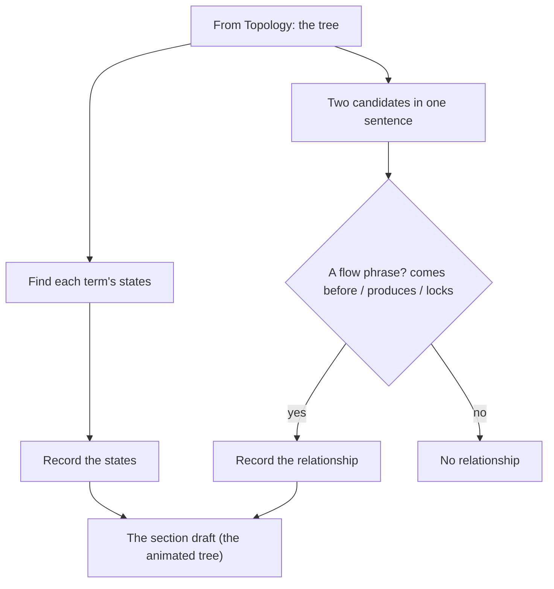
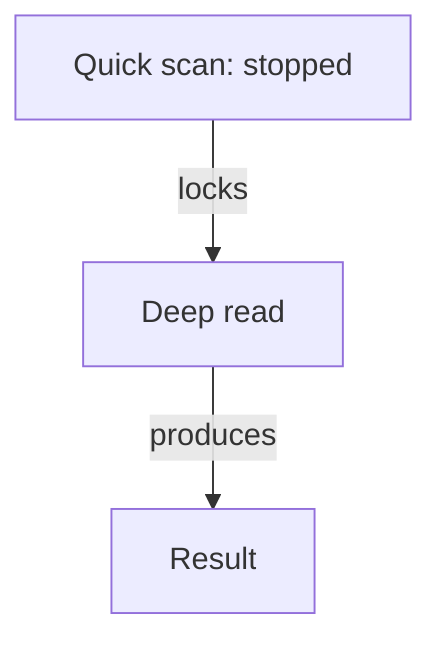

# Choreography — find how each candidate moves

> **What this is** — the third lens. It takes the candidates Ontology found and records how they move: the states a term can be in, and the flow relationships between candidates — what comes before what, what produces what, what locks or unlocks what.
> **What it is not** — it does not find new candidates (`lens1-ontology.md`) or place them (`lens2-topology.md`), and its output does **not** become glossary entries — flow is behaviour, and behaviour belongs in the specification, not the dictionary.
> **Related docs**
>
> - `otc-methodology.md` (how the lenses connect)
> - `lens1-ontology.md`
> - `lens2-topology.md`
> - `otc-run-rules.md`
> - words: `method-words.md`
>
> **Next step** — its states feed back as candidates; its flow relationships become the arrows in the picture.

## Choreography at a glance

This blows out the third lens: it begins with Topology's tree, animates it with states and flow relationships, and that animated tree is the section draft.

## Input

- **Topology's tree** for the section — the placed candidates whose movement to trace (they carry Ontology's candidates).
- **The section text** — to read the states and the phrases between candidates.

## Procedure — do in order

1. **States:** for each term, record the conditions it can be in.
2. **Flow relationships:** for each pair of candidates in a sentence, look for a flow give-away phrase.
3. **Classify** each as `comes before`, `produces`, or `locks / unlocks`.
4. **Record** states per term, and each flow relationship as a triple with its evidence phrase.
5. **Stop** if there is no phrase. No phrase, no relationship.

## The relationships this lens reads

| Relationship | Meaning | Give-away phrases |
|---|---|---|
| **comes before** | A then B in the flow | "then", "proceeds to", "moves to", "hands off to" |
| **produces** | A creates B | "generates", "hands back", "ends in", "presents its" |
| **locks / unlocks** | A controls whether B can happen | "cannot ... until", "stays closed until", "enabled once", "blocks" |
| *(states)* | the conditions a single term passes through | "can be paused, resumed, stopped"; "marked incomplete" |

## Rules this lens enforces (inline)

- Record a flow relationship only where a flow phrase exists — no phrase, no relationship.
- States are candidates; flow relationships are behaviour, not glossary entries.
- Exclude UI / mechanism states (buttons, fields) — capture the product state, never the control.

## Output — states and the flow

Choreography's output goes into part 3 of the section draft, "How they move", filled from `templates/section-glossary.md`:

- **States** - one table, with the columns of that table in part 3 of `templates/section-glossary.md`, copied exactly; the states go one per line, and the Evidence cell is the exact quote from the source and where it is.
- **The flow, step by step** - a numbered list in `comes before` order; under each step, what it produces, locks, or unlocks, each as its "reads as" sentence ([G5](glossary-assembly-principles.md#g5)).
- **Every flow relationship, as a table (verbatim)** - the columns of that table in part 3 of `templates/section-glossary.md`, copied exactly; the Evidence cell is the exact quote from the source and where it is. Rows are grouped by the first candidate. The source of truth.
- **The picture (diagram)** - a mermaid `first -->|relationship| second` graph of the same relationships.

**How to read this table (reading key):** the first candidate *produces* the second, *locks* or *unlocks* it, or *comes before* it. The "reads as" cell says the relationship in a plain sentence, for example `locks` reads "<First> stops <second> from happening."

**Casing.** Candidates, states, and mermaid labels are written in sentence case per G6 in `glossary-assembly-principles.md`, so they look exactly as they will in the glossary; a term in a given state is written `Term: state` (for example "Quick scan: stopped"); relationship words stay lower case; the Evidence cell keeps the source's own casing.

## Worked example — from the real requirements

Continuing the shared section. **From Ontology** we have the candidates — *quick scan, deep read, result*, and the rest. **From Topology** we have the structure — *a result contains findings; a gap is a kind of finding*. **Choreography now adds their movement** — the states each term can be in, and the flow between them, as part 3 of the section draft shows them.

> "The quick scan can be paused, resumed, stopped, and restarted; a stopped scan is incomplete, and the deep read stays closed until the scan resumes. Deep analysis reads a source in depth and presents its result."

**States each candidate can be in**

| Belongs to | States | Evidence |
|---|---|---|
| Quick scan | • Running • Paused • Stopped • Restarted • Incomplete (once stopped) | • "can be paused, resumed, stopped, and restarted" • "a stopped scan is incomplete" |

**The flow, step by step**

1. Quick scan: stopped
   - Quick scan: stopped stops deep read from happening.
2. Deep read
   - A deep read creates a result.

**Every flow relationship, as a table (verbatim)**

| First | Relationship | Second | Reads as | Evidence |
|---|---|---|---|---|
| Quick scan: stopped | locks | Deep read | Quick scan: stopped stops deep read from happening. | "the deep read stays closed until the scan resumes" |
| Deep read | produces | Result | A deep read creates a result. | "Deep analysis reads a source in depth and presents its result" |

**The picture (diagram)**

## The one boundary that matters

Choreography's output does **not** create glossary entries — a flow relationship like "a stopped scan locks the deep read" is a rule of the product, and rules live in the specification, not the glossary. Choreography earns its place in two other ways: a **state it finds** (e.g. "incomplete") is a named condition, so it loops back to Ontology as a candidate; and a **flow relationship it finds** becomes a flow arrow in the assembly draft.

## What about UI states — buttons, fields?

We do not capture them. UI controls — buttons, fields, toggles, modals — were dropped by Ontology as *mechanism*, so they are never candidates, and Choreography tracks states only for candidates. A button being enabled or disabled is the **visible echo** of a product state, not a state in its own right. We capture the product state it echoes, never the control.

- **We capture:** `deep read — locked` and the flow relationship `a stopped quick scan → locks → deep read` (the meaning, from the requirement).
- **We do not capture:** "the start button is disabled" or "the field is greyed out" (the *how* — a downstream design choice).

This is the same "no how-words" line the whole method holds: state what is true of the product, never the control that reflects it.

## Hand-off

The animated tree **is** the section draft. Its states go back to Ontology's States and values table as candidates; its flow relationships are the flow. Nothing here is a glossary definition. Across sections, the section draft is joined to others on shared candidates (`otc-methodology.md`).
