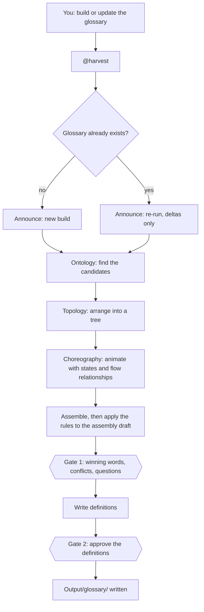
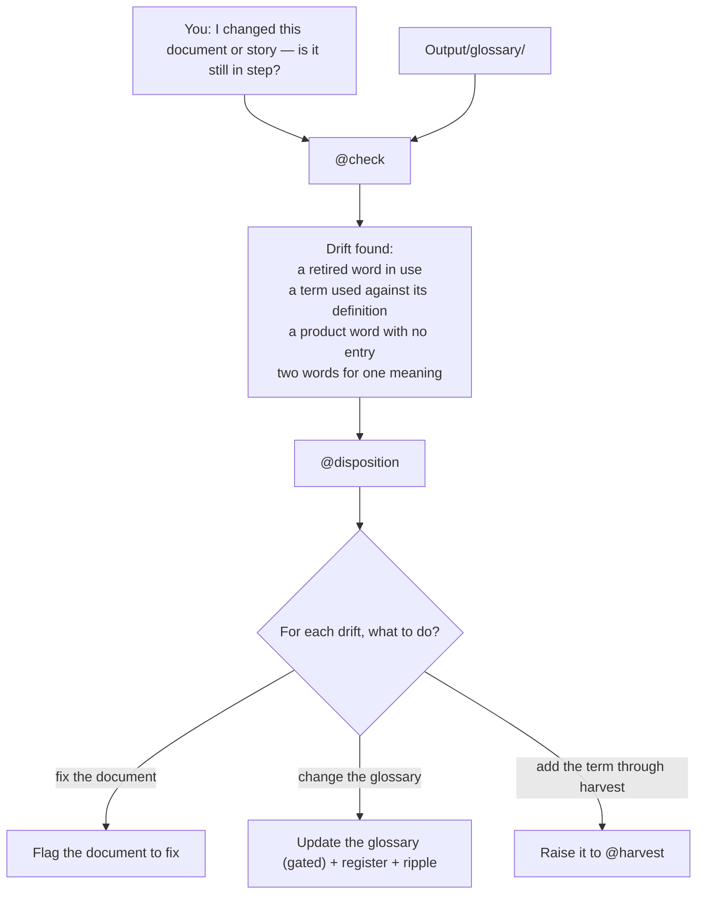
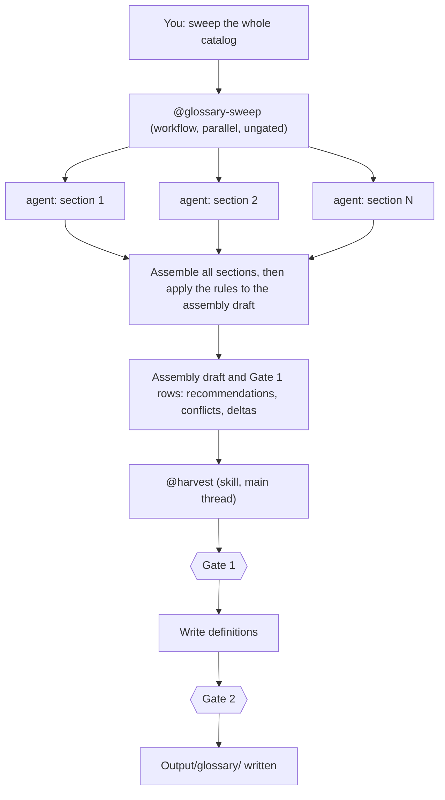

# Orchestration — where you invoke what

`@` marks an **invocation point** — where you call a skill or the workflow. There are three ways to run the glossary: **build** it (`@harvest`), **keep a changed document in step** with it (`@check` then `@disposition`), and **build at scale** (`@glossary-sweep`). Skills run in the main thread and pause at a gate; the workflow runs in the background and hands its result to `@harvest` for the gates. Only the skills decide or write.

## 1. Build or update the glossary — `@harvest`

## 2. Keep a changed document in step — `@check` then `@disposition`

A document or story has changed and you suspect it has drifted from the glossary. `@check` finds the drift; `@disposition` decides and acts on it. They are a **pair** — a delta you can see but not dispose of is no use.

`@disposition` can also be invoked **directly** for a known glossary change (e.g. "rename this term") — without a `@check` first.

## 3. Build at scale — `@glossary-sweep` (the workflow)

Invoked when you want the **whole catalog** read at once rather than section by section. It only reads, in parallel; it cannot gate, so it hands the assembly draft and the Gate 1 rows to `@harvest` for the gates and the writing.

Each agent runs the three lenses — Ontology, then Topology, then Choreography — on its own section, producing its section draft. The agents run in parallel, then converge to be assembled.

### Before fan-out: confirm the scaffolding

The sweep creates many folders at once, so it declares them first. Before spawning any agent, it shows the paths it will use — the seven glossary pages and every `deep-dives/` file (each section's folder, the assembly draft, and the gate log) — as a tree, one file per line, using the layout in `output-formats.md` ("The run root"), and **stops for confirmation whenever there is a fork:**

- **more than one glossary** (the catalog splits into distinct segregations) — it shows each glossary's own set of paths and confirms the split before creating anything;
- **a re-run would remove a section folder** the source no longer has — it asks before removing it.

Otherwise it announces the tree and proceeds. The confirmed glossary folder is **what each agent is handed**, so no agent invents its own paths — which is what keeps a parallel run's layout predictable.

### How the sweep briefs its agents

The sweep never repeats the method in each agent's prompt. Each agent is handed one standing brief that points at the shared method:

| Agent | Brief | Does | Writes |
|---|---|---|---|
| section agent (one per section) | `.skills/_shared/glossary/sweep-reader-brief.md` | runs the three lenses on its one section, inline rules only | `deep-dives/<section>/<section>-glossary.md` |
| assembly agent (one per glossary) | `.skills/_shared/glossary/sweep-builder-brief.md` | joins the section drafts, runs the rules over the assembly draft, writes the Gate 1 rows | `deep-dives/glossary-assembly-draft.md` and the Gate 1 part of `deep-dives/gate-log.md` |

The briefs carry only what parallel running adds — scope, read-only, where to write, what to hand back — and they **reference** the method files rather than restate them, so the one-shared-method rule below still holds. The agents read only; `@harvest` holds both gates and writes `Output/glossary/`, recording each gate to a durable gate log (`output-formats.md`, "The gate log") that blocks the run until the person clears every open gate row.

## The rule that ties them together

The **skills decide and write**; the **workflow only reads, in parallel**, and feeds `@harvest`. `@check` and `@disposition` are a pair — find the drift, then dispose of it. All of them follow the one shared method in `.skills/_shared/glossary/`; none restates it.

**Adding a skill or prompt.** Every skill or prompt for the glossary - the three here, the two prompts, and any added later - names `.skills/_shared/glossary/method-words.md` among what it reads and uses only its words (`method-words.md`, rule 6). One that does not is incomplete.
