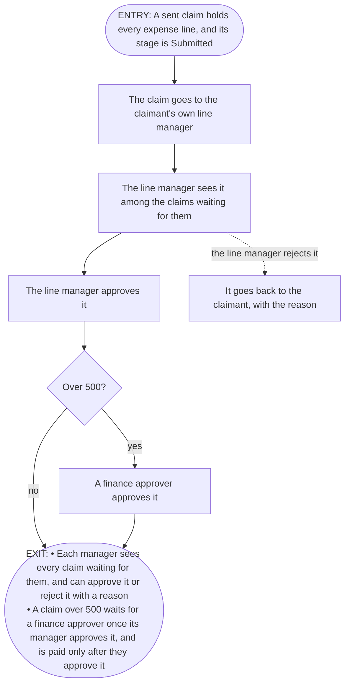

# FRD-3a Claim approval

Status: drafted

- **Depends on:** the features outside this capability that its features need first, as the catalog's "Depends on" lists them
  - F-01 Send a claim
- **Last changed:** None yet.
- **Excludes:** every other feature in the same section of the catalog, in ID order, then any feature or section this FRD's own requirements name
  - None

**Requirements**

- **REQ-3.1 Line manager approval** — The claimant's line manager approves every claim.
- **REQ-3.2 Finance approval** — Claims over 500 need finance approval.

## Features covered

| Feature ID | Feature | Description | Req. ID | Priority |
|---|---|---|---|---|
| F-04 | Manager approval | A line manager approves or rejects each claim from their team, so that only checked claims are paid | REQ-3.1 | Must |
| F-05 | Finance approval | The finance team also approves each claim over 500, so that large claims get a second check | REQ-3.2 | Must |

## Gates

| | Condition | Tied to |
|---|---|---|
| **In** (true before start) | A sent claim holds every expense line, and its stage is Submitted | F-01 Send a claim |
| **Out** (this unlocks) | • Each manager sees every claim waiting for them, and can approve it or reject it with a reason • A claim over 500 waits for a finance approver once its manager approves it, and is paid only after they approve it | None. |
| **Undone if** | None. | None. |

## Actors

| Actor | What they do in this capability |
|---|---|
| Line manager | • see the claims waiting for them • approve a claim • reject a claim, with a reason |
| Finance approver | • see the claims waiting for them • approve a claim over 500 |
| Claimant | • see their own claims • see the reason their claim was rejected |

## Rules

### F-04 Manager approval

| Rule | The system shall… | Source |
|---|---|---|
| F-04.1 | show each line manager every claim waiting for their approval | F-04.dw1 — Each manager sees every claim waiting for them |
| F-04.2 | let a line manager approve a claim waiting for them | F-04.dw2 — can approve it |
| F-04.3 | let a line manager reject a claim waiting for them | F-04.dw3 — reject it with a reason |
| F-04.4 | **not** accept a rejection that gives no reason | F-04.dw3 — reject it with a reason |
| F-04.5 | **only** show each person their own claims, or the claims waiting for them | data model — Claim, Browse |
| F-04.6 | send each claim to the claimant's own line manager | data model — Claim, Approve |
| F-04.7 | **only** let the claimant's own line manager reject a claim | data model — Claim, Reject |
| F-04.8 | show the claimant the reason their claim was rejected | proposed — Why: each rejection gives a reason, but no file says whether the claimant sees it. Showing it tells the claimant what to put right in a new claim |

### F-05 Finance approval

| Rule | The system shall… | Source |
|---|---|---|
| F-05.1 | send a claim over 500 to a finance approver once its line manager approves it | F-05.dw1 — A claim over 500 waits for a finance approver once its manager approves it |
| F-05.2 | let a finance approver approve a claim over 500 | F-05.dw2 — is paid only after they approve it |
| F-05.3 | **not** pay a claim over 500 until a finance approver approves it | F-05.dw2 — is paid only after they approve it |
| F-05.4 | **only** send a claim to a finance approver when it is over 500 | data model — Claim, Approve over the limit |

## Coverage — every Done-when piece has a rule

| Done-when | Clause | Proved by |
|---|---|---|
| F-04.dw1 | Each manager sees every claim waiting for them | F-04.1 |
| F-04.dw2 | can approve it | F-04.2 |
| F-04.dw3 | reject it with a reason | F-04.3 and F-04.4 |
| F-05.dw1 | A claim over 500 waits for a finance approver once its manager approves it | F-05.1 |
| F-05.dw2 | is paid only after they approve it | F-05.2 and F-05.3 |

**From the requirement (not a Done-when):**
- None

**From the data model (not a Done-when):**
- F-04.5
- F-04.6
- F-04.7
- F-05.4

**From your decisions, not from the documents:**
- F-04.8

## Coverage — every data model answer has a rule

| Thing | Action, field or move | Proved by |
|---|---|---|
| Claim | Browse | F-04.5 |
| Claim | Approve | F-04.6 |
| Claim | Reject | F-04.7 |
| Claim | Approve over the limit | F-05.4 |

## Flow

**Entry:** A sent claim holds every expense line, and its stage is Submitted *(Gate in)*.

1. The claim goes to the claimant's own line manager *(F-04.6)*
2. The line manager sees it among the claims waiting for them *(F-04.1)*
- *Alternate:* Each person sees only their own claims, or the claims waiting for them *(F-04.5)*
3. The line manager approves it *(F-04.2)*
- *Alternate:* The line manager rejects it *(F-04.3)*
- *Alternate:* Only the claimant's own line manager can reject it *(F-04.7)*
- *Alternate:* A rejection that gives no reason is not accepted *(F-04.4)*
- *Alternate:* The claimant sees the reason their claim was rejected *(F-04.8)*
4. A claim over 500 goes to a finance approver once its line manager approves it *(F-05.1)*
5. A claim of 500 or less never goes to a finance approver *(F-05.4)*
6. The finance approver approves it *(F-05.2)*
7. A claim over 500 is not paid until the finance approver approves it *(F-05.3)*

**Exit:** • Each manager sees every claim waiting for them, and can approve it or reject it with a reason • A claim over 500 waits for a finance approver once its manager approves it, and is paid only after they approve it *(Gate out)*.

## Data

### Claim

From [claims.md](../glossary/data-models/claims.md).

| Field | Type | Required | Limits | Can two share it | Can change | Starts as |
|---|---|---|---|---|---|---|
| expense lines | several Expense lines | yes, only when it is sent | 1 or more | no | only while Draft | – |
| stage | one of: • Draft • Submitted • Approved • Rejected • Paid | yes | – | – | moves: see How stage moves | Draft |
| amount | number | yes, only when it is sent | in euros, Proposed (needs confirmation), question 4 | – | only while Draft | – |

## Standard questions

1. *Can it be changed after it is added? Which parts?*
2. *Can it be removed?*
3. *Can two be the same, and on what?*
4. *When several are added at once, what happens if some fail?*
5. *Who can do each of these?*
6. *What is its starting status?*
7. *What changes in each status?*

| Thing | Question | Answered by |
|---|---|---|
| Claim | Can it be changed after it is added? Which parts? | claims.md, Claim Change -> F-01 Send a claim |
| Claim | Can it be removed? | claims.md, Claim Remove -> F-01 Send a claim |
| Claim | Can two be the same, and on what? | claims.md, Claim expense lines -> F-01 Send a claim |
| Claim | When several are added at once, what happens if some fail? | Does not apply — the PRD and claims.md never add several claims at once |
| Claim | Who can do each of these? | PRD, REQ-3.1 -> F-04.2 and F-04.3 |
| Claim | What is its starting status? | claims.md, Claim stage -> F-01 Send a claim |
| Claim | What changes in each status? | claims.md, Claim stage -> F-01 Send a claim |

## Decision record

None yet.

## Check record

None yet.
